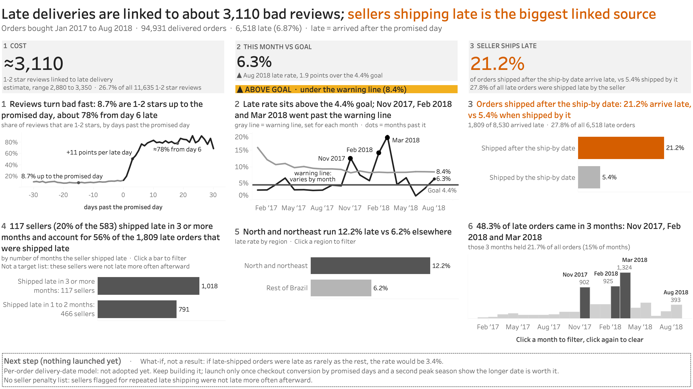
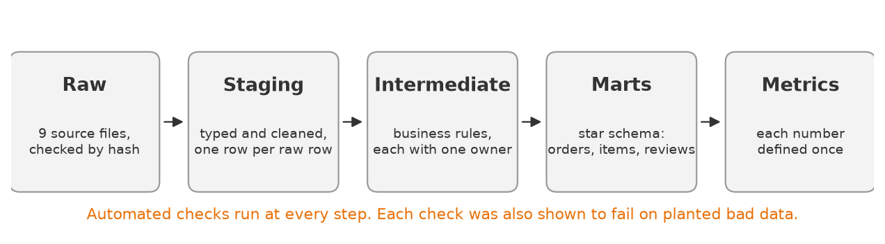
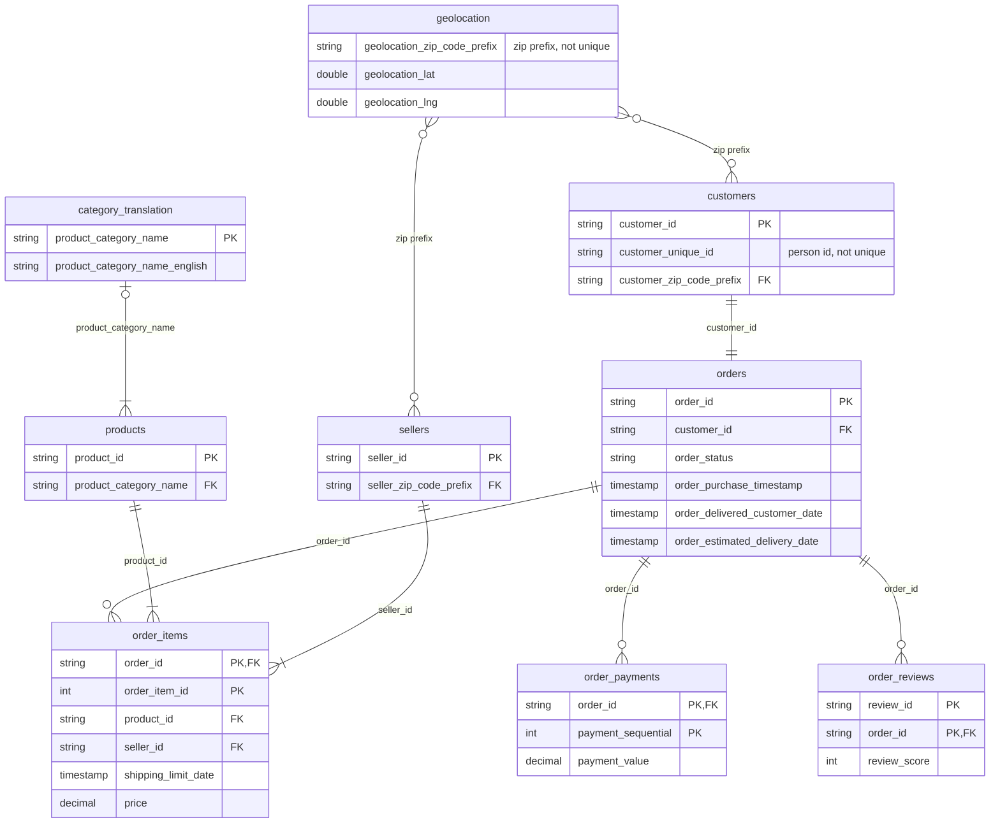
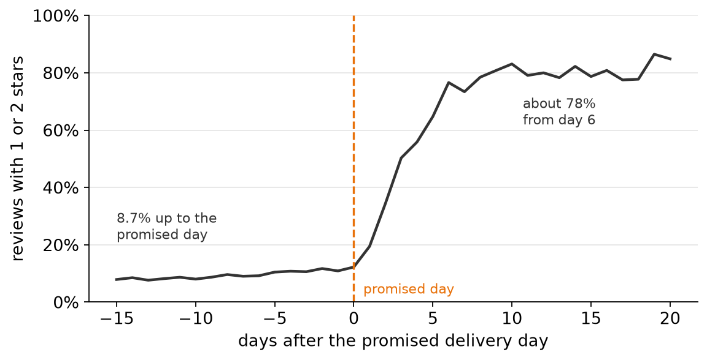
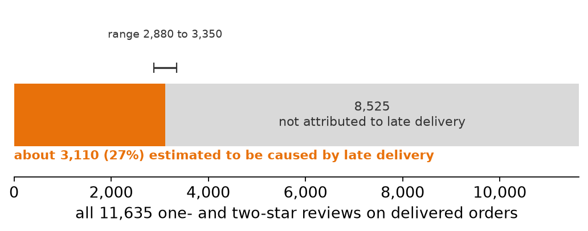
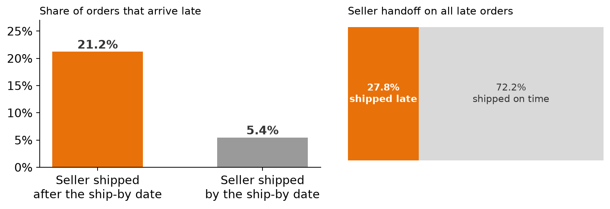
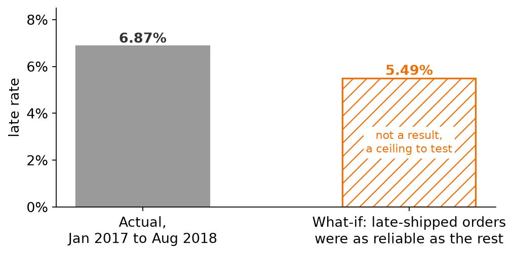

# Late deliveries and bad reviews at Olist

This project builds a tested data pipeline from about 99,000 real orders of Olist, a Brazilian online marketplace, and uses it to estimate what late delivery costs. Late delivery is the estimated cause of about 3,110 of the 11,635 one- and two-star reviews on 94,931 delivered orders, about 27%, with a range of 2,880 to 3,350, and it shows no clear effect on repeat buying. The recommendation is two randomized tests, starting with reminders to sellers about their ship-by date, because 27.8% of late orders were handed to the carrier late.

*The dashboard in one view. [Open the live, clickable version](https://mikemoose1.github.io/olist-ecommerce-analytics/#live-dashboard).*

**Scope.** An end-to-end analytics project on a public dataset. It covers data modeling in dbt and DuckDB, automated data checks, a review-cost estimate, a recommendation memo and a Tableau dashboard. The cause figure is an estimate from past orders, not a randomized test. [The limits](#limits-what-is-causal-and-what-is-only-linked) say what is causal and what is only linked.

## Question

What does late delivery cost Olist, and where should an operations manager act first? An order counts as late when it arrives on a later calendar day than the promised date. The question is broken into a tree of measurable parts in [story/QUESTIONS.md](story/QUESTIONS.md).

## Approach

*Each step has its own checks, so a wrong number is caught where it starts.*

The source is nine tables from 2016 to 2018. Orders are the hub that items, payments, reviews and customers hang from.

*Keys and links of the nine source tables. Each one was tested against the raw files. For the built models, see [the dbt lineage graph](docs/LINEAGE.md).*

Three problems in the tables would have skewed the results.

- Every order has a new customer ID. There are 99,441 IDs for 96,096 people, so repeat buyers look like strangers until they are matched on the person ID.
- 1,278 orders ship from several sellers but carry one delivery date, so their late status cannot be observed. They are left out of the late rate.
- Review surveys can be sent before the parcel arrives. By calendar day, 5.19% of the reviews on delivered orders are dated before delivery.

The cost estimate compares each late order with the same seller's orders that arrived just on time, in the same product category and month. Details are in [MODELING.md](MODELING.md), [the lineage graph](docs/LINEAGE.md) and [review_cost_causal/](review_cost_causal/README.md).

## Findings

**Late orders are rare and rated much lower.** 6.87% of delivered orders (6,518 of 94,931) arrived late. Late orders average 2.27 stars and on-time orders 4.31. Among reviewed orders, 62.4% of late ones get one or two stars, against 8.7% of on-time ones.

*Bad reviews climb about 11 points for each day late and level off near 78% from day 6. Part of the climb is survey timing.*

**About a quarter of the bad reviews are an estimated effect of lateness.** The estimate is about 3,110 of 11,635 (27%), and six reasonable ways of comparing give 2,880 to 3,350.

*Roughly one bad review in four on delivered orders is estimated to come from late delivery.*

**Repeat buying shows no clear effect.** 1.28% of customers order again within 90 days. After matching, customers whose first order was late came back 0.10 points less often, with a range of -0.52 to 0.22 points that includes zero.

**Lateness clusters in time and place.** Three months (November 2017, February 2018 and March 2018) hold 48.3% of late orders and 21.7% of all orders. The north and northeast regions run 12.2% late.

**Seller handoff is the biggest fixable cause found.** On 9.0% of orders the seller handed the parcel to the carrier after the ship-by date. Those orders were late 21.2% of the time, against 5.4% when the handoff was on time.

*Orders shipped after the ship-by date are about four times as likely to arrive late, and they make up 27.8% of late orders.*

## Recommendation

Run two randomized tests before any rollout. Details and measures are in [recommendation/MEMO.md](recommendation/MEMO.md).

1. **Ship-by reminders.** Half of the sellers, picked at random, get a reminder the day before each ship-by date and a visible on-time score. The other half see no change. Measure the share of late handoffs first, then the late rate and average stars, over 8 weeks.
2. **Buffer days in the promise.** For north and northeast addresses and in high-lateness months, add buffer days to the promised date on a random half of orders. Measure average stars and checkout conversion first. Conversion is not in the data and is the main risk.

*A ceiling for test 1, not a result. About 1,300 fewer late orders (20.6% of them) would take the late rate from 6.87% to 5.49%.*

## How it was verified

- Each headline number is recalculated straight from the raw files and matches ([evidence/verification_report.md](evidence/verification_report.md)).
- The keys and links in the diagram above pass 36 of 36 checks against the raw files ([case_study/erd.py](case_study/erd.py)).
- Every data check was shown to fail on planted bad data. All 248 rules in the check suite are proven this way ([evidence/mutation_report.md](evidence/mutation_report.md)).
- Every number in the memo is tied to the analysis output, and a script fails if one drifts ([recommendation/memo_check.py](recommendation/memo_check.py)).
- Every number on this page is checked against the warehouse by [case_study/check_case_study.py](case_study/check_case_study.py).
- GitHub Actions rebuilds the project and reruns all checks on every change. One command, `make`, reproduces everything ([docs/REPRODUCE.md](docs/REPRODUCE.md)).

## Limits: what is causal and what is only linked

| Statement | Status | Why |
|---|---|---|
| Late delivery caused about 3,110 bad reviews | Estimated cause | Compared with the same seller's orders in the same category and month. It is an estimate from past orders, not a randomized test. |
| Part of that effect is survey timing | Linked | 74.5% of late orders' surveys went out before delivery, so some customers rated while still waiting. |
| Hidden seller sloppiness inflates the estimate | Small | If it sat inside every late order it would explain about 150 of the reviews at the top of its range. |
| Late handoff leads to late arrival | Linked | The carrier may have been late anyway. The reminder test is what would show cause. |
| Late delivery lowers repeat buying | Not shown | The range includes zero, so the data cannot tell a real drop from chance. |
| The star penalty holds over time | Smaller recently | It was 1.56 stars in the last four months, against 2.05 earlier. |

The data has no revenue, commission or checkout figures, so the case for fixing lateness rests on ratings, not on money.

## What's next

Neither test has run. Test 1 needs seller-level random assignment and 8 weeks of orders. The what-if rate above is its upper bound until then.

## Go deeper

| To see | Open |
|---|---|
| The one-page decision memo | [recommendation/MEMO.md](recommendation/MEMO.md) |
| The estimate and its checks | [review_cost_causal/README.md](review_cost_causal/README.md) |
| The data story and KPI tree | [story/QUESTIONS.md](story/QUESTIONS.md) |
| The dashboard and how it was built | [dashboard/tableau/README.md](dashboard/tableau/README.md) |
| Every table, grain and rule | [MODELING.md](MODELING.md) |
| Setup, tests and every number | [docs/REPRODUCE.md](docs/REPRODUCE.md) |

Data: the public [Olist Brazilian e-commerce dataset](https://www.kaggle.com/datasets/olistbr/brazilian-ecommerce) on Kaggle. Raw files are downloaded, not committed.
