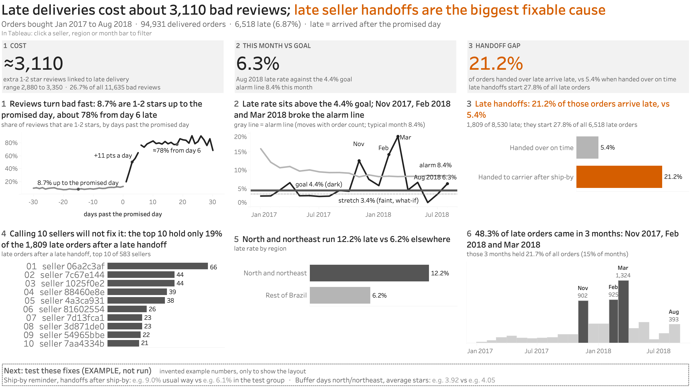

# Tableau dashboard (layout B1, version 2)

The late-delivery dashboard as a Tableau Desktop workbook, with the script that builds it and the checks that show its clicks work. Tableau draws it. Every number comes from `dashboard/data/` and the dbt warehouse; none is typed in. Where the labels sit (which months are named, where the goal and alarm labels go) is set by hand for this data window.



The title says the finding: late deliveries cost about 3,110 bad reviews, and late seller handoffs are the biggest fixable cause. Three tiles (cost, this month against the 4.4% goal, handoff gap 21.2% vs 5.4%), then trend, why, and where. Gray everywhere, orange only for the handoff gap. Panel 6 is an invented example, as in the data README.

## Files

| File | What it is |
|---|---|
| `out_b1_v2.twb` | the workbook. It reads its CSVs from `/path/to/olist_dash/data` (a placeholder: regenerate for your own folder, below, or repoint the data source in Tableau). |
| `B1_v2.png` | the exported image of the dashboard |
| `gen_workbook.py`, `ctrl_saved_desktop_free.twb` | builds the workbook XML from a control file saved by Tableau Desktop (hand-written workbooks do not open) |
| `prep.py` | makes `ramp_b.csv` and `monthly_long.csv` from `dashboard/data/` |
| `export_orders.py` | writes `orders.csv` from the warehouse: one row per judged order, the 94,931 delivered single-seller orders bought January 2017 to August 2018 |
| `harness/` | Mac-only tools: `export_dash.py` (open a workbook, export the image, then quit Tableau), `click_probe.py` + `mclick.js` (click a mark and export). Run them from this folder layout; settings are in each script's header and can be changed with environment variables. |
| `evidence/` | the click tests: a note per test and the images (downscaled to 1366 x 768; the notes give the md5 of the full-size exports) |

`orders.csv` is about 12 MB, so it is not committed. `export_orders.py` rebuilds it from the warehouse.

`ctrl_saved_desktop_free.twb` is a small workbook saved by Tableau Desktop on the Mac it was built on. Its sample data source still names `/path/to/data/monthly_late.csv`. `gen_workbook.py` copies only the part of the file before the data sources, so that path does not reach the output.

## Regenerate

```bash
make build dashboard                      # warehouse and dashboard/data
mkdir -p /tmp/olist_tableau && cp dashboard/data/summary.csv dashboard/data/tests_example.csv /tmp/olist_tableau/
python3 dashboard/tableau/prep.py dashboard/data /tmp/olist_tableau
python3 dashboard/tableau/export_orders.py /tmp/olist_tableau/orders.csv      # needs the duckdb package; OLIST_DB_PATH picks the warehouse
python3 dashboard/tableau/gen_workbook.py /tmp/olist_tableau /tmp/olist_tableau dashboard/tableau/out_b1_v2.twb
```

The last command writes `dashboard/tableau/out_b1_v2.twb`, which replaces the committed file. Its two folder arguments differ for a reason. The first is where the script reads the CSV headers from. The second is the folder written into the workbook as the place Tableau reads the CSVs from. The committed workbook names `/path/to/olist_dash/data`, so a workbook built with `/tmp/olist_tableau` differs from it only in the three data-folder lines; pass `/path/to/olist_dash/data` as the second argument to get the committed text exactly.

What was checked, on the machine that built the dashboard (2026-11-19, against the warehouse copy it used): the `orders.csv` from `export_orders.py` and the two CSVs from `prep.py` were byte-identical to the files behind the committed workbook, and `gen_workbook.py` with the Mac data path gave a file identical to `out_b1_v2.twb`. It has not been re-run on another machine or against a fresh `make build`.

Settings you may meet: `VAR` (b1 three tiles, shipped, or b2 one-line strip), `ONLY` (build only the named sheets, separated by `|`), `REF` (for `prep.py`: leave the goal and stretch data lines out), `OPT` (read but unused); `gen_workbook.py`'s header lists the rest (`TR`, `GSZ`, `SSZ`, `PAT`, `FILT`, `TIPV`, `X`).

## Clicking filters the other panels

Clicking a seller, a region bar or a month bar filters the sellers, handoff, region and months panels. The tiles, the chart titles and the trend panel always show all orders. Tableau, not an image, is needed for this: run it in Tableau Desktop.

All three were tested on the shipped `out_b1_v2.twb` in Tableau Desktop 2026.3 on 2026-11-19: a real mouse click, then Dashboard > Export Image, compared with a DuckDB query on the same filter. After each click, clicking again gave an export with the same md5 as the unfiltered one (`ff0f1e64...`), so one `baseline.png` stands for all three clears.

| Click | Result | Matches DuckDB |
|---|---|---|
| seller `06a2c3af` | handoff 3.0% / 54.5% (was 5.4% / 21.2%), region 22.4% / 18.2%, month labels Feb 2, Mar 17, Aug 1 | yes |
| region North and northeast | handoff 11.0% / 24.5%, sellers 16, 8, 4, 0, 4, 0, 6, 4, 1, 1, month labels Nov 161, Feb 147, Mar 252, Aug 11 | yes |
| month Mar 2018 | handoff 17.7% / 34.6%, region 33.6% / 17.4%, sellers 13, 5, 2, 16, 5, 0, 7, 0 (ranks 9 and 10 had no orders that month), Mar bar 1,324 | yes |

Images: `evidence/baseline.png`, `click_seller.png`, `click_region.png`, `click_month.png`. Notes and the md5 of each full-size export: `evidence/click_seller.md`, `evidence/click_region_month.md`. The seller test was run twice on this file, with the same result. The harness needs macOS Accessibility permission for the app that runs it. It puts Tableau in Presentation Mode, which centres the 1366 x 768 dashboard, and works out the click position from the layout. A click that comes from `System Events` is an accessibility press, not a mouse click, and does not select a mark.

## Goal and stretch lines

The 4.4% goal and the 3.4% stretch line are Tableau reference lines whose value comes from a parameter, so each gets its own thickness: the goal is a heavy solid line, the stretch line a thin dashed one. An earlier try pointed the line at a data column and did not draw.

**The alarm line cannot be dashed.** It changes with each month's order count (small early months get a higher line), so it is a data line, not a constant. In the Tableau files and notes checked, only reference lines, reference bands, trend lines and gridlines carry a dash setting. A data line has one thickness and one style for the whole chart. This was not proven impossible by every route in Desktop.

## Other limits found

- A workbook with italic text runs does not open, so the example numbers in the bottom strip are gray, not italic.
- Tableau Public is not used. Nothing here publishes anything.
