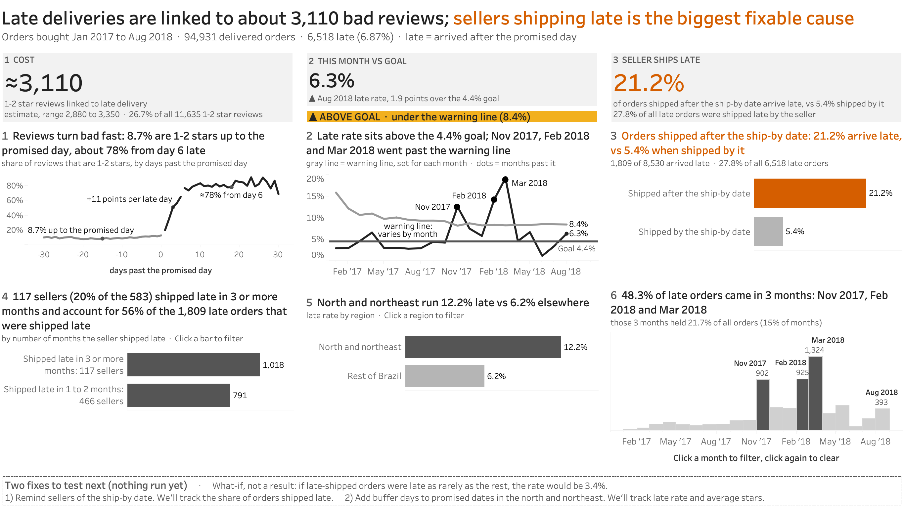

# Tableau dashboard (layout B1, version 2, wording v3)

The late-delivery dashboard as a Tableau Desktop workbook, with the script that builds it and the checks that show its clicks work. Tableau draws it. Every number comes from `dashboard/data/` and the dbt warehouse; none is typed in. Where the labels sit (which months are named, where the goal, stretch and warning-line labels go) is set by hand for this data window.


The title says the finding: late deliveries are linked to about 3,110 bad reviews, and sellers shipping late is the biggest fixable cause. The wording is deliberately not causal: the 3,110 is an estimate from past orders, not a controlled test. Three tiles (cost, this month against the 4.4% goal, seller ships late 21.2% vs 5.4%), then trend, why, and where. Gray everywhere, orange only for orders shipped after the ship-by date. The strip at the bottom names two fixes to test next, with what each would track; it holds no numbers and nothing has been run.

The wording is plain on purpose ("seller ships late", "warning line"), after a comparison with well-rated public dashboards. The data tables and the dbt models keep the older names (handoff, alarm line, stretch what-if); only the words on the dashboard changed. Each clickable panel carries its own click hint. Every figure in the text is built from `summary.csv` when the workbook is generated, including the "1.9 points over the goal" in tile 2 (latest month's late rate minus the goal) and the "other 573 sellers, 81%" line under the seller bars (583 sellers with a late-shipped late order, minus 10; one minus the top-10 share). The warning line's note says what it means in a few words; that it moves with each month's order count is not on the dashboard any more (there was no room).

## Files

| File | What it is |
|---|---|
| `out_b1_v2.twb` | the workbook. It reads its CSVs from `/path/to/olist_dash/data` (a placeholder: regenerate for your own folder, below, or repoint the data source in Tableau). |
| `B1_v2.png` | the exported image of the dashboard |
| `gen_workbook.py`, `ctrl_saved_desktop_free.twb` | builds the workbook XML from a control file saved by Tableau Desktop (hand-written workbooks do not open) |
| `prep.py` | makes `ramp_b.csv` and `monthly_long.csv` from `dashboard/data/`, including the line labels |
| `export_orders.py` | writes `orders.csv` from the warehouse: one row per judged order, the 94,931 delivered single-seller orders bought January 2017 to August 2018 |
| `harness/` | Mac-only tools: `export_dash.py` (open a workbook, export the image, then quit Tableau), `click_probe.py` + `mclick.js` (click a mark and export). Run them from this folder layout; settings are in each script's header and can be changed with environment variables. |
| `evidence/` | the click tests: a note per test and the images (downscaled to 1366 x 768; the notes give the md5 of the full-size exports) |

`orders.csv` is about 12 MB, so it is not committed. `export_orders.py` rebuilds it from the warehouse.

`ctrl_saved_desktop_free.twb` is a small workbook saved by Tableau Desktop on the Mac it was built on. Its sample data source still names `/path/to/data/monthly_late.csv`. `gen_workbook.py` copies only the part of the file before the data sources, so that path does not reach the output.

## Regenerate

```bash
make build dashboard                      # warehouse and dashboard/data
mkdir -p /tmp/olist_tableau && cp dashboard/data/summary.csv /tmp/olist_tableau/
python3 dashboard/tableau/prep.py dashboard/data /tmp/olist_tableau
python3 dashboard/tableau/export_orders.py /tmp/olist_tableau/orders.csv      # needs the duckdb package; OLIST_DB_PATH picks the warehouse
python3 dashboard/tableau/gen_workbook.py /tmp/olist_tableau /tmp/olist_tableau dashboard/tableau/out_b1_v2.twb
```

The last command writes `dashboard/tableau/out_b1_v2.twb`, which replaces the committed file. Its two folder arguments differ for a reason. The first is where the script reads the CSV headers from. The second is the folder written into the workbook as the place Tableau reads the CSVs from. The committed workbook names `/path/to/olist_dash/data`, so a workbook built with `/tmp/olist_tableau` differs from it only in the three data-folder lines; pass `/path/to/olist_dash/data` as the second argument to get the committed text exactly.

What was checked (2026-11-19, against the warehouse copy the dashboard was built from): the three CSVs and the workbook above were regenerated by these commands for this version, the workbook was opened in Tableau Desktop 2026.3 on the Mac and exported to `B1_v2.png`, and a 52-line number check (every figure on the image against DuckDB and `summary.csv`, plus the new computed ones and the workbook text) had no mismatch. The number check script is not in the repo. `orders.csv` itself is not committed. It has not been re-run on another machine or against a fresh `make build`.

Settings you may meet: `VAR` (b1 three tiles, shipped, or b2 one-line strip), `ONLY` (build only the named sheets, separated by `|`), `REF` (for `prep.py`: leave the goal and stretch data lines out), `OPT` (read but unused); `gen_workbook.py`'s header lists the rest (`TR`, `GSZ`, `SSZ`, `PAT`, `FILT`, `TIPV`, `X`).

## Clicking filters the other panels

Clicking a seller, a region bar or a month bar filters the sellers, shipped-late, region and months panels. The tiles, the chart titles and the trend panel always show all orders. Tableau, not an image, is needed for this: run it in Tableau Desktop.

All three were tested on the shipped `out_b1_v2.twb` (this wording version) in Tableau Desktop 2026.3 on 2026-11-19: a real mouse click, then Dashboard > Export Image, compared with a DuckDB query on the same filter. After each click, clicking again gave an export with the same md5 as the unfiltered one (`7ec795fb...` for the region and month runs, `3d7e2dc7...` for the final seller re-run), so one `baseline.png` stands for the clears. The click hints on the dashboard are in the panels: the seller and region hints in each panel's note line, the month hint under the months chart.

| Click | Result | Matches DuckDB |
|---|---|---|
| seller `06a2c3af` | shipped by / after the ship-by date 3.0% / 54.5% (was 5.4% / 21.2%), region 22.4% / 18.2%, month labels Feb 2, Mar 17, Aug 1 | yes |
| region North and northeast | shipped by / after 11.0% / 24.5%, sellers 16, 8, 4, 0, 4, 0, 6, 4, 1, 1, month labels Nov 161, Feb 147, Mar 252, Aug 11 | yes |
| month Mar 2018 | shipped by / after 17.7% / 34.6%, region 33.6% / 17.4%, sellers 13, 5, 2, 16, 5, 0, 7, 0 (ranks 9 and 10 had no orders that month), Mar bar 1,324 | yes |

Images: `evidence/baseline.png`, `click_seller.png`, `click_region.png`, `click_month.png`. Notes and the md5 of each full-size export: `evidence/click_seller.md`, `evidence/click_region_month.md`. The seller test was run twice on this file, with the same result. The harness needs macOS Accessibility permission for the app that runs it. It puts Tableau in Presentation Mode, which centres the 1366 x 768 dashboard, and works out the click position from the layout. A click that comes from `System Events` is an accessibility press, not a mouse click, and does not select a mark.

## Goal and stretch lines

The 4.4% goal and the 3.4% stretch line are Tableau reference lines whose value comes from a parameter, so each gets its own thickness: the goal is a heavy solid line, the stretch line a thin dashed one. An earlier try pointed the line at a data column and did not draw.

**The warning line (the alarm line in the data) cannot be dashed.** It changes with each month's order count (small early months get a higher line), so it is a data line, not a constant. In the Tableau files and notes checked, only reference lines, reference bands, trend lines and gridlines carry a dash setting. A data line has one thickness and one style for the whole chart. This was not proven impossible by every route in Desktop.

## Other limits found

- A workbook with italic text runs does not open, so text on the dashboard is never italic.
- Chart 2 labels are a squeeze. The goal label ("Goal 4.4% (a typical steady month)") is a three-line label at the left of the trend chart and touches the gray warning line and the small bump in early 2017. The what-if label ("What-if 3.4%: late-shipped like the rest") sits under the dashed line and its two ends touch the black line. It is short on purpose: the reviewer's longer wording ("If late-shipped orders were late as rarely as the rest: 3.4% (what-if)") landed on top of the goal line in every placement tried, so the full wording is only in the line's hover caption. What the what-if means: the late rate in a typical stable month if late-shipped orders were late no more often than the rest.
- The "Mar" month label touches the top of the line (the March peak is the top of the chart). Raising it by an offset changed the y-axis scale (tick marks every 10 points instead of 5) and shrank the plot, so it was left as is.
- The "8.7% up to the promised day" label sits right next to the y-axis labels. The seller ID header ("Seller (anonymized ID)") is part of the panel's note line, and the panel's note does not say "top 10 by late-shipped late orders" for lack of room; the title says "top 10 sellers" and the bars are late orders shipped late. The export has no seller state, so none is shown.
- Tableau Public is not used. Nothing here publishes anything.

## Six-chart version (v4)

A second page next to B1: one dashboard with six charts instead of the B1 layout, with the seller panel redrawn around repeat sellers.



What changed against B1:

- **Sellers panel.** Bars are the number of months a seller shipped late: "3 or more months" (117 sellers, 20% of the 583, 1,018 of the 1,809 late orders that were shipped late) and "1 to 2 months" (466 sellers, 791). The title says the 56%.
- **Four reader fixes on the trend and months charts**
  1. Warning line: its end label (8.4%) and a short note ("warning line: varies by month") sit at the line, and the line is solid.
  2. Months chart: each tagged bar is named with month and year (Nov 2017, Feb 2018, Mar 2018, Aug 2018) and carries its late-order count. The count is a sum over the clicked data, so it follows the click filters.
  3. No label sits on another label or on a line: the late-rate (6.3%) and warning-line (8.4%) end labels are in a right-hand margin at different heights, and the goal label is on the right under the goal line.
  4. The three dots for months past the warning line sit exactly on the late-rate line's points (each dot is a centred text mark on the point itself).
- Labels are placed by data: each is a one-point series whose month is where it is drawn and whose value is only its height, so no number on the page comes from those series.

| File | What it is |
|---|---|
| `out_v4_six_chart.twb` | the workbook (data folder placeholder `/path/to/olist_dash/data`) |
| `v4_six_chart.png` | the exported image, full size |
| `prep3.py`, `prep4.py` | CSVs for this page (step 1 reads the warehouse, step 2 adds the label series and the month tags) |
| `gen_v4.py` | builds the workbook XML (same control file as B1) |
| `numbers_check_v4.py` | 82-line number check; output in `evidence/v4/numbers_check_v4.txt` |
| `click_expect.py`, `harness/click_probe4.py` | expected values for each click from DuckDB; the Mac click harness for this layout |
| `evidence/v4/` | click test: `results.md`, `expected.md`, four images (downscaled to 1366 x 768) |

### Regenerate

```bash
# B1 inputs first (see Regenerate above): summary.csv, ramp_b.csv, monthly_long.csv in /tmp/olist_tableau
export OLIST_DB=olist.duckdb SEEDS=seeds B1DATA=/tmp/olist_tableau   # warehouse file, seeds folder, B1 CSV folder
python3 dashboard/tableau/prep3.py /tmp/olist_v4/data3                # needs the duckdb package
python3 dashboard/tableau/prep4.py /tmp/olist_v4/data3 /tmp/olist_v4/data4
PROTO=P2 NCH=6 TREND=e SELL=repeat YEARTAG=1 \
  python3 dashboard/tableau/gen_v4.py /tmp/olist_v4/data4 /path/to/olist_dash/data dashboard/tableau/out_v4_six_chart.twb
DATA=/tmp/olist_v4/data4 TWB_DIR=dashboard/tableau python3 dashboard/tableau/numbers_check_v4.py
```

The second `gen_v4.py` argument is the folder written into the workbook as where Tableau reads the CSVs; the committed file uses the placeholder. Copy the CSVs from `data4` to the folder you name there, or pass that folder as the argument. `orders.csv` is about 21 MB and is not committed.

### What was checked (2026-11-20)

- The CSVs and the workbook were regenerated from the warehouse with the commands above; the CSVs are byte-identical to the ones the exported image was built from, and the workbook differs from the one opened in Tableau only in the data-folder path.
- The number check passes: 82 checks, 0 mismatches (every figure and label on the page against DuckDB, `summary.csv`, the CSVs and the workbook text). A deliberately wrong dot height, end label and bar count each turned up as a mismatch when tried, so the checks can fail.
- Click test in Tableau Desktop 2026.3 on the Mac (`evidence/v4/results.md`): seller-group, region and month clicks each match the warehouse, and clicking again returns an export with the baseline's md5.

| Click | shipped by / after the ship-by date | region N/NE / rest | months Nov / Feb / Mar / Aug | sellers | vs DuckDB |
|---|---|---|---|---|---|
| none | 5.4% / 21.2% | 12.2% / 6.2% | 902 / 925 / 1,324 / 393 | 1,018 / 791 | match |
| seller bar "3 or more months" | 6.1% / 23.5% | 13.6% / 7.8% | 461 / 381 / 555 / 99 | 1,018 | match |
| region North and northeast | 11.0% / 24.5% | 12.2% / (greyed) | 161 / 147 / 252 / 11 | 139 / 94 | match |
| month Nov 2017 | 9.3% / 34.0% | 20.3% / 11.6% | 902 (others greyed) | 203 / 114 | match |

The "1 to 2 months" bar was not clicked (expected values are in `evidence/v4/expected.md`).

### Not cleanly fixed

- Month and count labels on the months chart are positioned with padding characters, because Tableau offers no per-label offset. The "Feb 2018" name now clears the Mar 2018 bar. Under some click filters the Feb count (for example "147") sits flush against the left edge of the Mar bar.
- The label placement is set by hand for this data window (Jan 2017 to Aug 2018); other data would need the padding and fixed axis range revisited.
- Dual-axis circle marks for the dots were tried and abandoned: Tableau did not accept a hand-written dual axis, so the dots are centred text marks.
