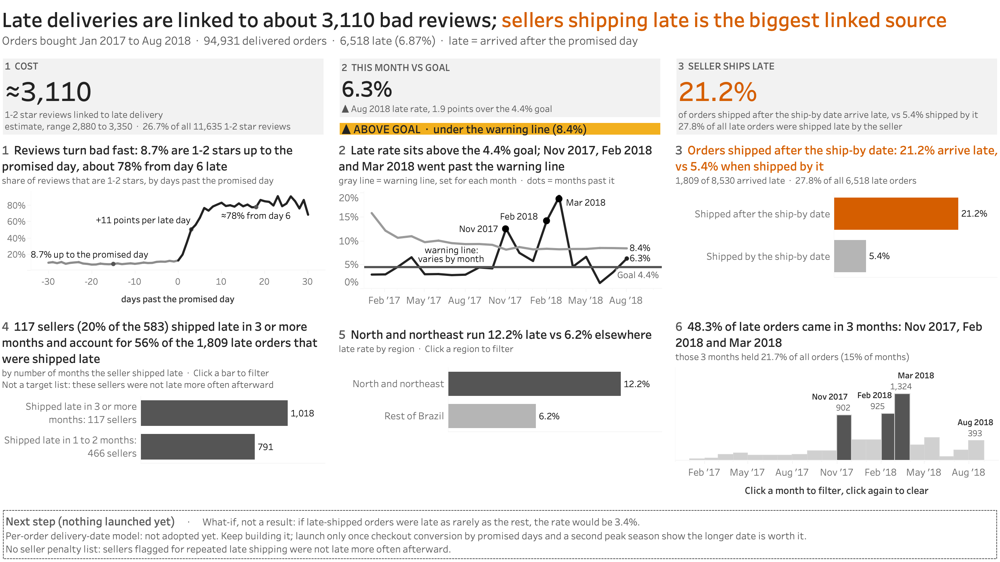
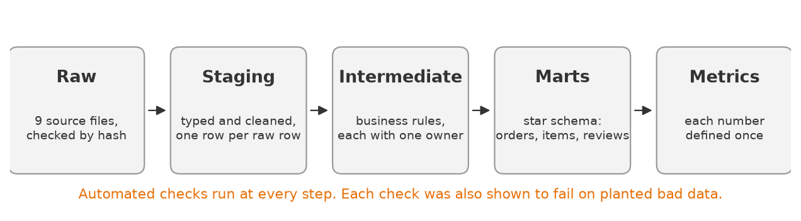
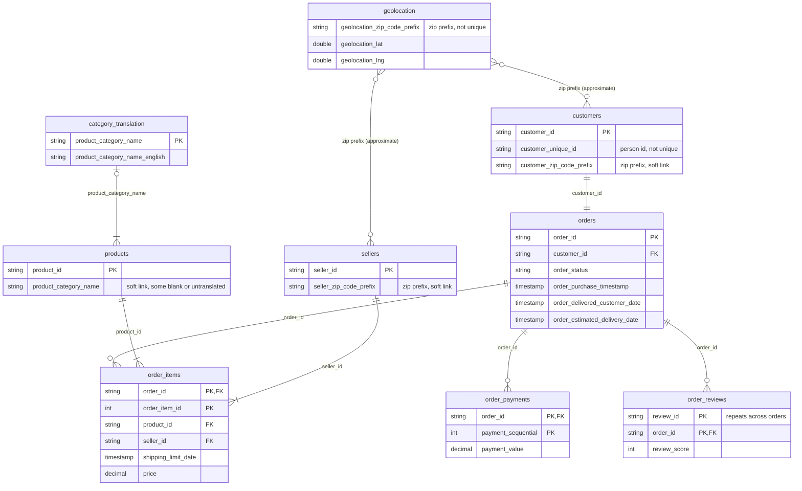
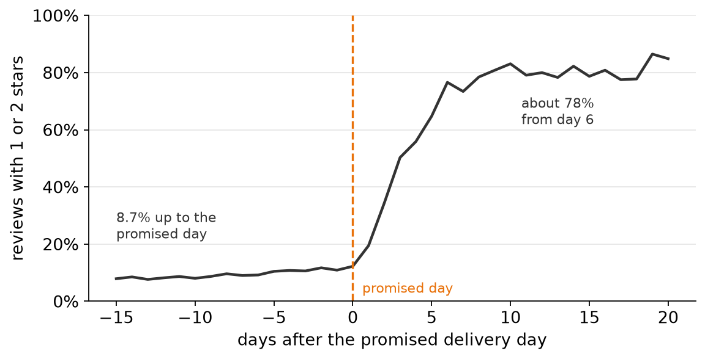
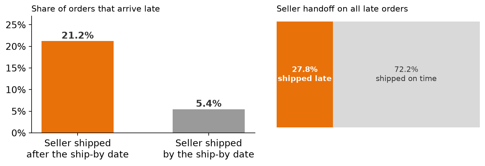
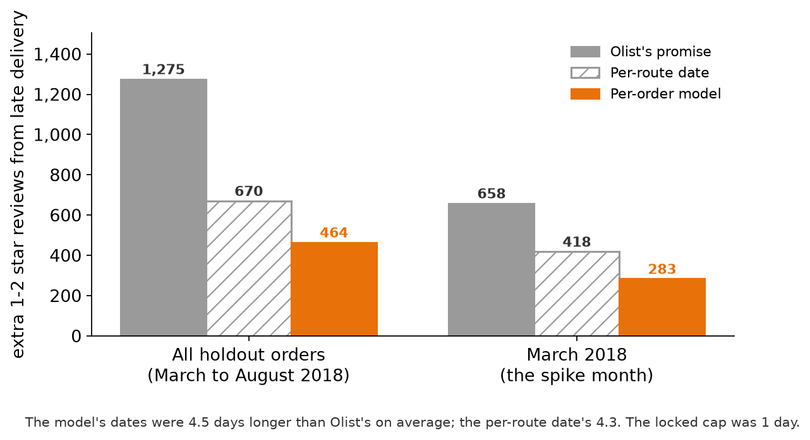
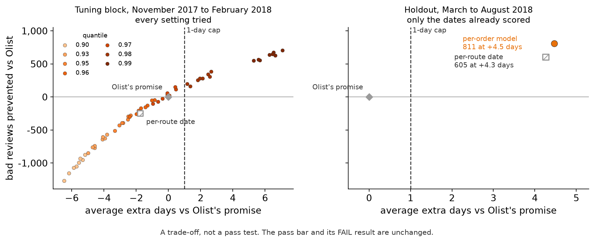

# Late deliveries and bad reviews at Olist

This project builds a tested data pipeline from about 99,000 real orders of Olist, a Brazilian online marketplace, and uses it to estimate what late delivery costs. The analysis found an estimated effect of late delivery on about 3,110 of the 11,635 one- and two-star reviews on 94,931 delivered orders, about 27%, with a range of 2,880 to 3,350. It is an estimate from past orders, not a randomized test, so it is not proven cause. There is too little repeat buying in the data to tell whether late delivery lowers it. The star penalty for a late order was smaller in the last four months of the window: 1.56 stars, against 2.05 earlier. The lead recommendation is a per-order delivery-date model. Scored once on held-out orders from March to August 2018, it would have cut extra late-delivery bad reviews by about 64% (about 811 of 1,275), but only by printing dates 4.5 days longer than Olist's on average, so it failed its pass bar and is not adopted now. Olist's printed promise stays. The model is worth rebuilding, with the length cap built in, once Olist's checkout data, which this dataset does not have, shows whether a longer date is worth it.

*The dashboard in one view. Click the image for the full-size picture. The interactive version is coming.*

**Role and tools.** An end-to-end analytics project on a public dataset: data modeling and automated data checks in dbt and DuckDB, the review-cost analysis in Python (pandas and statsmodels), a delivery-date model (scikit-learn), a recommendation memo, a Quarto data story and a Tableau dashboard. GitHub Actions rebuilds and checks all of it.

**Code.** This repository. The main folders are [models/](../models/) (the dbt layers), [tests/](../tests/) (data checks), [review_cost_causal/](../review_cost_causal/README.md) (the estimate), [recommendation/](../recommendation/MEMO.md) (the memo), [dashboard/](../dashboard/tableau/README.md) (the Tableau workbook and its data) and [case_study/](../case_study/) (the checks behind this page). The short summary is the [README](../README.md).

## Question

What does late delivery cost Olist, and where should an operations manager act first? An order counts as late when it arrives on a later calendar day than the promised date. The question is broken into a tree of measurable parts in [story/QUESTIONS.md](../story/QUESTIONS.md).

## Approach

*Each step has its own checks, so a wrong number is caught where it starts.*

The source is nine tables from 2016 to 2018. Orders are the hub that items, payments, reviews and customers hang from.

*Keys and links of the nine source tables. Soft links (zip prefixes and product category) are not keys. A review ID can repeat across orders. Each mark was tested against the raw files, including that every column marked FK has a unique parent and no orphans. For the built models, see [the dbt lineage graph](LINEAGE.md).*

Three problems in the tables would have skewed the results.

- Every order has a new customer ID. There are 99,441 IDs for 96,096 people, so repeat buyers look like strangers until they are matched on the person ID.
- 1,278 orders ship from several sellers but carry one delivery date, so their late status cannot be observed. They are left out of the late rate.
- Review surveys can be sent before the parcel arrives. By calendar day, 5.19% of the reviews on delivered orders are dated before delivery.

The ZIP-prefix and product-category columns are drawn as soft links, not keys, because the data does not keep them unique or complete. A review ID can appear on more than one order.

### What the words mean

An ontology here is the project's agreed list of business concepts: what each one means, and where it lives in the data. The table and the rules below are generated from [ontology/ontology.yml](../ontology/ontology.yml), and a script checks them against the warehouse.

| Concept | Meaning | Lives in |
|---|---|---|
| Customer ID | A receipt number. Olist issues a new one for every order, so it cannot show a repeat buyer. | `staging.stg_customers.customer_id` |
| Person | A real buyer, identified by customer_unique_id. "Customer" in every metric means person. | `marts.dim_customer.customer_unique_id` |
| Order | One checkout by one customer. It can contain items from several sellers. | `marts.fct_orders.order_id` |
| Late | Delivered on a later calendar day than the promised date. Same-day delivery is on time. | `metrics.metric_late_rate_orders.is_late` |
| Ship-by date | The deadline Olist gives a seller to hand the parcel to the carrier. It is kept per item, and the order's ship-by date is the latest one among its items. | `marts.fct_orders.last_shipping_limit_at` |
| Handoff to carrier | The moment the seller gave the parcel to the carrier, as recorded on the order. Some orders have none. | `marts.fct_orders.delivered_to_carrier_at` |
| Late handoff | The handoff time is later than the order's ship-by time, compared as full timestamps. An order with no handoff time is in neither group. | `marts.fct_orders.delivered_to_carrier_at` |
| Multi-seller order | An order with items from two or more sellers (2+ parcels). Its parcels can arrive on different days, but Olist records one delivery date. | `marts.fct_orders.n_parcels` |

### What counts as late

Late. Delivered on a later calendar day than the promised date. Same-day delivery is on time. It is judged only on the late-rate population, after the filters below.

Late handoff. The handoff time is later than the order's ship-by time, compared as full timestamps. An order with no handoff time is in neither group. Among the judged orders, 94,930 have a handoff time and 8,530 of them were handed over late. 1 judged order has no handoff time and is in neither group.

### Which orders are judged

The late rate uses a defined set of orders, not every row. The project setting `multi_seller_late_rule` is `exclude_multi_seller`. Each row shows how many orders remain after that filter.

| Step | Rule | Orders left | Removed |
|---|---|---|---|
| A | All orders in the source | 99,441 |  |
| B | Delivered, with a delivery date (delivery_state on time or late) | 96,470 | 2,971 |
| C | At least one item (n_items above zero) | 96,470 | none |
| D | Bought in the analysis window (in_analysis_window) | 96,203 | 267 |
| E | Single-seller orders only (delivery evidence is not multi-parcel) | 94,931 | 1,272 |

The 1,272 orders removed at the last step are the multi-seller orders that were still left. The source has 1,278 such orders. The other 6 were already removed by an earlier step. Each seller ships its own parcel, but the data keeps one delivery date for the order, so whether it was late cannot be observed.

Not delivered or conflicting: 2,957 not delivered, 14 with a status that disagrees with the delivery date. These orders have no reliable delivery outcome.

The cost estimate compares each late order with the same seller's orders that arrived just on time, in the same product category and month. Details are in [MODELING.md](../MODELING.md), [the lineage graph](LINEAGE.md) and [review_cost_causal/](../review_cost_causal/README.md).

## Findings

**Late orders are rare and rated much lower.** 6.87% of delivered orders bought from January 2017 to August 2018 (6,518 of 94,931) arrived late. Late orders average 2.27 stars and on-time orders 4.31. Among reviewed orders, 62.4% of late ones get one or two stars, against 8.7% of on-time ones.

*Bad reviews climb about 11 percentage points for each day late and level off near 78% from day 6. Part of the climb is survey timing.*

**About a quarter of the bad reviews are an estimated effect of lateness.** The estimate is about 3,110 of 11,635 (27%). The 2,880 to 3,350 range is the spread of six comparison methods, not a confidence interval: same seller, category and month with a just-on-time baseline (the preferred method); the same with any on-time baseline; same product; plus customer state; same actual delivery time; and no seller matching. The preferred method's own 95% interval is 3,025 to 3,195.

*Roughly one bad review in four on delivered orders is estimated to come from late delivery.*

**There is too little repeat buying to tell whether lateness lowers it.** 1.28% of customers (991 of 77,560) order again within 90 days. Only 3.04% (2,887 of 94,983) ever ordered twice. The 94,983 is every customer with a qualifying order, all time, not limited to the late-rate window, and counts a same-day second order as a repeat; the 77,560 is the customers who had a full 90 days of follow-up. After matching, customers whose first order was late came back 0.10 percentage points less often, with a range of -0.52 to 0.22 percentage points that includes zero.

**Lateness clusters in time and place.** Three months (November 2017, February 2018 and March 2018) hold 48.3% of late orders and 21.7% of all orders. The north and northeast regions run 12.2% late.

**Late seller handoff is the biggest linked source of lateness found.** On 9.0% of orders the seller handed the parcel to the carrier after the ship-by date. Those orders were late 21.2% of the time, against 5.4% when the handoff was on time.

*Orders shipped after the ship-by date are about four times as likely to arrive late, and they make up 27.8% of late orders.*

*A ceiling, not a result. About 1,300 fewer late orders (20.6% of them) would take the late rate from 6.87% to 5.49%, if late-shipped orders were as reliable as the rest.*

**Why the dashboard says 3.4% and this page says 5.49%.** Both ask the same what-if: what would the late rate be if late-shipped orders were late only as often as the rest. They start from different bases. The 5.49% is the pooled version: it takes all 94,931 orders and moves the late rate from 6.87% to 5.49%. The 3.4% is the dashboard's version for a typical stable month: it moves the median stable month from the 4.4% goal down to 3.4%, a drop of about 1.0 percentage point. The pooled rate is higher because it includes the three spike months that a typical month leaves out.

### The 4.4% goal and the 8.4% warning line

Both lines on the dashboard's monthly chart come from the data, not from a target set by hand. The warning line is a control limit: the average late rate of the 17 months left in the fit, including the 2 thin months, plus three standard deviations, widened to match how much the rate really swings from month to month, which is far more than chance alone would give (a Laney p-prime chart, method in [late_rate_targets/spc.py](../late_rate_targets/spc.py)). It sits at 8.4% for a typical month of 6,372 orders, and higher for smaller months. A month above it is a real change, not bad luck. Three months crossed it: November 2017, February 2018 and March 2018. The goal, 4.4%, is the median late rate of the 15 stable months, so half of them already beat it. A stable month is one that is not above the warning line and has at least 2,000 orders, the cutoff used to drop thin months from the goal. Stable means not extreme. It does not mean healthy.

## Recommendation

The code, the pass bar and the full results are in [recommendation/delivery_date_model/README.md](../recommendation/delivery_date_model/README.md). The one-page memo is [recommendation/MEMO.md](../recommendation/MEMO.md).

### Keep building a per-order delivery-date model as the promise engine, but do not adopt this version

This version failed the bar written before its holdout was scored, so it is not adopted and Olist's printed promise stays for now. The recommendation is to keep building the per-order model as Olist's promise engine, rebuild it next round with the length cap inside the model, and launch it only once checkout conversion by promised days and a second peak season are available and show the longer date is worth it.

At checkout, the model sets each order's date from facts known at that moment: the route's past delivery times, the distance, the seller's past handoff speed and lateness, the parcel, the freight, Olist's own printed lead time and how busy the platform is. It is gradient boosting that predicts a high percentile of the delivery time. At the start of every month it is retrained on all orders already delivered by then, so the first model learns only from orders bought January to October 2017. It was built the way a production model would be: trained on orders bought January to October 2017, tuned on November 2017 to February 2018, and scored once on a holdout of March to August 2018, after the pass bar was written down. One caveat on that order: an earlier per-order model and the per-route date had already been scored over the whole window, holdout months included, in the promise backtest below, so this design was shaped after earlier looks at the holdout months. The tuning code never read the holdout.

*Extra late-delivery bad reviews on the holdout: about 1,275 under Olist's printed promise, about 670 under the per-route date and about 464 under the model. In March 2018: 658, 418 and 283.*

- **Gain.** On the 38,307 reviewed holdout orders, extra late-delivery bad reviews fall from about 1,275 under Olist's printed promise to about 464, a cut of about 811 (64%), with a range of 773 to 852 from 5,000 resamples of orders. That is about 21 fewer per 1,000 reviewed orders, and about 206 fewer than the simpler per-route date (range 183 to 230). 97.3% of orders arrive by the model's date, against 92.9% for Olist's and 96.3% for the per-route date. These counts are replay estimates: actual delivery times are held fixed and the review effects come from past orders.
- **Cost.** The model's dates are 4.5 days longer than Olist's on average (median 26 days against 22). Most of the cut comes from printing a later date where a parcel is likely to run late. In tuning the same setting was only 0.4 days longer than Olist's; the gap grew because Olist shortened its own promise from an average of 25.7 days in the tuning block to 22.5 on the holdout, and the model's dates did not shorten with it.
- **Why it is not ready.** The cap on extra length, 1 day, was missed by a wide margin. In tuning, none of the 56 settings passed: every setting short enough for the cap did worse than Olist in November 2017, the first peak season the model met, with no earlier November to learn from. By the rule written before the holdout was scored, the model is not adopted in this round.
- **Owner.** The delivery-promise product owner, with logistics. The commercial lead sets the conversion threshold.
- **Decision rule.** Launch when Olist's checkout data shows that dates about 4.5 days longer cost fewer sales than the commercial lead will trade for about 21 fewer bad reviews per 1,000 orders.
- **Data it needs.** Checkout conversion by promised days, which is not in this data, and a second peak season to train and test on.

*Each point is one delivery date: the late-delivery bad reviews it prevents against Olist's promise, by how many days longer it is on average. This chart shows the trade-off. It is not a pass test, and the FAIL result above is unchanged. Left, all 56 settings tried on the tuning block: the best within the 1-day cap cut about 150 at 0.4 days longer, every setting that cut more was over the cap, and the per-route date did worse than Olist there (about 248 more). Right, the holdout shows only the dates already scored on it, the model and the per-route baseline, with Olist's promise at the origin: the model cut about 811 at 4.5 days longer and the per-route date about 605 at 4.3. No other setting was scored on the holdout.*

### Do not build a seller penalty list from past lateness

A list of sellers who were late in past months looks like an obvious target. Built as of each month, using only orders delivered by then, with sellers who had orders both handed to the carrier late and delivered late in 3 or more earlier months, the list holds 46 sellers in March 2018 and 106 by August. In the months that followed, those sellers handed parcels over late more often (11.4% of orders, against 6.9%), but their orders did not arrive late more often (6.9%, against 7.2%). They carried 18.1% of late orders on 18.6% of orders. A penalty or ranking program built on that list would not be expected to cut late deliveries.

- **Owner.** Marketplace seller operations.
- **Decision rule.** Revisit only if a list built the same way shows its sellers running late more often than the rest in the months after.
- **Data it needs** for any seller fix: seller operations and carrier files (pickups, routing, capacity).

### The simpler per-route date

The analysis also replayed history with a per-route delivery date, updated as orders arrive, in place of Olist's single promise. Actual delivery times were left unchanged. A 19-out-of-20 date is the 95th percentile of past delivery times on that route: 19 times out of 20, a parcel on the route had arrived by that day. On the 89,412 reviewed orders from April 2017 onward, the stricter 19-out-of-20 per-route date would likely have cut the extra one- and two-star reviews attributed to late delivery by about 9% (about 286 of 3,017), with a realistic range of about 8% to 11%, or about 225 to 345 reviews, from 5,000 resamples of orders. That cut is a net: about 2,337 orders that had been late would have been on time, avoiding about 894 bad reviews, while about 1,839 orders that had been on time would have been late, adding about 650, plus about 42 fewer from orders late either way. Dates were scored as a walk-forward as-of replay: a delivery entered history only if it arrived strictly before the purchase, after an April 2017 burn-in, with a fallback from the route to the customer's state to a global date and a minimum of 30 orders. If even the global history is thinner than that, a global date with no 30-order floor is used as a last resort. A looser 9-out-of-10 date failed the pre-declared pass bar and would have added about 1,739 extra bad reviews. The first promise-backtest model, a simpler per-order model, did not beat the per-route rule on accuracy. The per-route 19-out-of-20 date was the one that was judged. On 20 November 2026, pass-bar items 3 and 5 were reworded after the totals were known, to require the interval to sit on the reduction side; which dates passed did not change. This is a printed-date stopgap, not a logistics fix. On the March to August 2018 holdout above, the same per-route date cut about 605 extra bad reviews (range 568 to 646) but printed dates 4.3 days longer than Olist's on average, missing the same 1-day cap, so it is not recommended either. It is only the baseline the model is compared with. The data cannot show whether a different date would have changed who bought, or whether it would have raised repeat buying.

*A per-route 19-out-of-20 date cuts extra late-delivery bad reviews from about 3,017 to about 2,731, a net of about 286 (about 894 avoided, minus about 650 added, plus about 42 fewer from orders late either way).*

## How it was verified

- Each headline number is recalculated straight from the raw files and matches ([evidence/verification_report.md](../evidence/verification_report.md)).
- The keys and links of the nine source tables pass 51 of 51 checks against the raw files, including that every column marked FK has a unique parent and no orphans ([case_study/erd.py](../case_study/erd.py)).
- Every data check was shown to fail on planted bad data. All 248 rules in the check suite are proven this way ([evidence/mutation_report.md](../evidence/mutation_report.md)).
- The delivery-date model's holdout results are rebuilt from the warehouse on every run and must match its locked results ([recommendation/delivery_date_model/check_headlines.py](../recommendation/delivery_date_model/check_headlines.py)).
- Every number in the memo is tied to the analysis output, and a script fails if one drifts ([recommendation/memo_check.py](../recommendation/memo_check.py)).
- Every number on this page is checked against the warehouse by [case_study/check_case_study.py](../case_study/check_case_study.py).
- GitHub Actions rebuilds the project and reruns all checks on every change. One command, `make`, reproduces everything ([docs/REPRODUCE.md](REPRODUCE.md)).

## Stress tests

The rules for these stress tests were committed in [docs/preregistration_v2.md](preregistration_v2.md) before any of them ran. The planted-effect test and the delivery-range calibration missed their rules, and both are reported as fails.

| Test | Result | Rule | Outcome |
|---|---|---|---|
| Missing reviews, reweighted by inverse probability weighting ([write-up](../review_cost_causal/stress/MISSING_REVIEWS.md)) | 3,109, against 3,110 unweighted; the four all-bad and none-bad scenarios give 3,016 to 3,198 | Within 5% of 3,110 and inside the published range | Pass |
| Hidden confounder, E-value ([write-up](../review_cost_causal/stress/SENSITIVITY_AND_KNOWN_ANSWER.md)) | a hidden confounder would need an E-value of 5.1 to halve the estimate and 8.7 to explain it away | at least 2.0 to halve | Pass |
| Hidden confounder, Oster bound | the Oster delta to halve it is 3.53 with Rmax at 1.3 times the controlled R², and 0.30 with Rmax at 1 | at least 1 | Pass |
| Planted effect in a copy of the real orders | the preferred estimate's 95% interval covered the planted number in 20, 16 and 17 of 20 draws with no, half and full effect | at least 17 of 20 in each | Fail (half effect: 16 of 20) |
| Delivery-range model ([write-up and model card](../recommendation/delivery_range/README.md)) | holdout calibration error 14.8 points; holdout CRPS 3.601 days, against 3.784 for the route-history baseline | at most 3 points | Fail |

What the fails mean:

- **The planted-effect miss.** Across the no, half and full effect draws, the preferred method's 95% interval covered the planted number in 53 of 60 draws (88%), so do not quote 3,025 to 3,195 as a 95% range. The 2,880 to 3,350 range is the spread of six comparison methods, not a confidence interval. It is a sensitivity band, and it is no safer: in the same draws the spread of the six estimates covered the planted number in only 16, 10 and 12 of 20.
- **The calibration miss.** The delivery-range model predicts better than route history, but its stated levels are not promises: on the holdout, 64.8% of orders arrived by the date labelled 50%, a calibration error of 14.8 points, against a pre-registered limit of 3. Within the 1-day guardrail, the best decision rule is projected to cut 502 extra late-delivery bad reviews against Olist's date (95% bootstrap range 468 to 539) for 0.6 more promise days on average. That is projected from actual delivery days, not observed reviews under a new date, and the model needs recalibration on recent deliveries before any launch.

## Limits: what is causal and what is only linked

This page uses its labels the same way throughout. An estimated effect comes from comparing past orders and adjusting for seller, category and month. It is a reasonable estimate, not proven cause. Linked means seen together, with no cause claimed. Not shown means the data cannot tell.

| Statement | Status | Why |
|---|---|---|
| Late delivery is estimated to account for about 3,110 bad reviews | Estimated effect | Compared with the same seller's orders in the same category and month. It is an estimate from past orders, not a randomized test, so not proven cause. |
| Part of that effect is survey timing | Linked | 74.5% of late orders' surveys went out before delivery, so some customers rated while still waiting. |
| Hidden seller sloppiness inflates the estimate | Small | If it sat inside every late order it would explain about 150 of the reviews at the top of its range. |
| Late handoff leads to late arrival | Linked | The carrier may have been late anyway. Seller operations and carrier files would be needed to show cause. |
| Late delivery lowers repeat buying | Not shown | Too little repeat buying to tell. The range includes zero, so the data cannot tell a real drop from chance. |
| The star penalty holds over time | Smaller recently | It was 1.56 stars in the last four months, against 2.05 earlier. |
| The delivery-date model uses only facts known at checkout | Small known gap | Its seller handoff-speed input counts only orders that were eventually delivered, which is not fully known at checkout. Fixing it would mean scoring the holdout again, so it is disclosed instead. |

The dashboard title says "linked to" in both halves. Read the first as the estimated effect above, and the second, sellers shipping late as the biggest linked source, as the untested link in the handoff row. Its panel of repeat late-shipping sellers is marked as not a target list, for the reason in the recommendation.

Olist's commission and conversion are not in the data, so the case for fixing lateness rests on ratings, not on money. Sales values are in the orders; late orders in the last 12 months of the window carried R$1.0 million of sales.

## What the data couldn't answer

These are questions the data is too thin or too incomplete to answer. Weaker results, such as a date rule that made reviews worse, are covered in the method above, not here.

**Would fewer late deliveries, or a different printed date, raise repeat buying?** The people and their later orders are in the data, but there are too few repeat buyers and the follow-up is short, so the sample cannot tell a real change from chance. Only 3.04% of customers (2,887 of 94,983) ever ordered twice — that all-time count includes same-day second orders — and 1.28% (991 of 77,560) did so within 90 days among customers with 90 days of follow-up.

**Can orders just before and just after the promised date be compared as if the cutoff were as good as random?** The data can't support that design. Fewer parcels arrive one day late than the trend predicts (bunching at the promised date), so the cutoff check failed its density test and those groups are not alike.

**How should seller logistics be fixed?** The data shows whether a seller handed a parcel to the carrier after the ship-by date, but not why. There are no seller operations or carrier files (warehouse capacity, pickup failures, routing). Those files would be needed to design an operations fix.

**Would a later, more reliable date cost sales?** Checkout conversion is not in the data. The delivery-date model cuts bad reviews mostly by printing a later date where a parcel is likely to run late, so whether it pays depends on how many shoppers a later date turns away.

**Can a model learn the peak season?** The window holds a single November peak. In tuning, the model met November 2017 with no earlier November to learn from, and every setting within the length cap did worse than Olist's promise that month. A second peak season would be needed to train and test on.

## What's next

The delivery-date model needs checkout conversion by promised days and a second peak season, neither of which is in this data. With both, the next round rebuilds it with the length cap inside the model and scores it once on the new peak.

## Go deeper

| To see | Open |
|---|---|
| The one-page decision memo | [recommendation/MEMO.md](../recommendation/MEMO.md) |
| The delivery-date model, its pass bar and holdout | [recommendation/delivery_date_model/README.md](../recommendation/delivery_date_model/README.md) |
| The estimate and its checks | [review_cost_causal/README.md](../review_cost_causal/README.md) |
| The data story and KPI tree | [story/QUESTIONS.md](../story/QUESTIONS.md) |
| The dashboard and how it was built | [dashboard/tableau/README.md](../dashboard/tableau/README.md) |
| The official concept map | [ontology/ONTOLOGY.md](../ontology/ONTOLOGY.md) |
| Every table, grain and rule | [MODELING.md](../MODELING.md) |
| Setup, tests and every number | [docs/REPRODUCE.md](REPRODUCE.md) |
| The short summary | [README](../README.md) |

Data: the public [Olist Brazilian e-commerce dataset](https://www.kaggle.com/datasets/olistbr/brazilian-ecommerce) on Kaggle. Raw files are downloaded, not committed.
