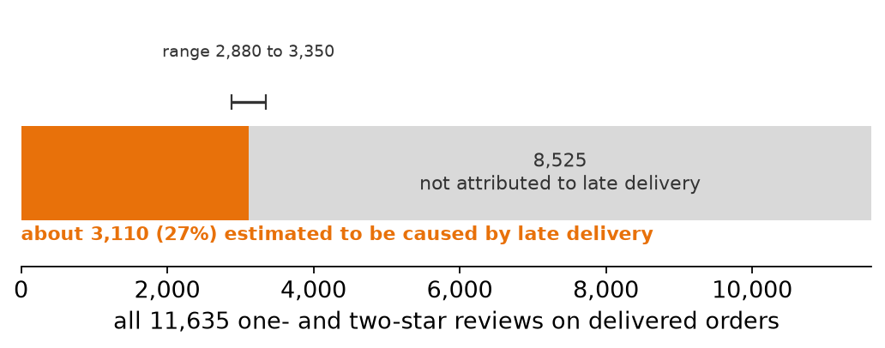
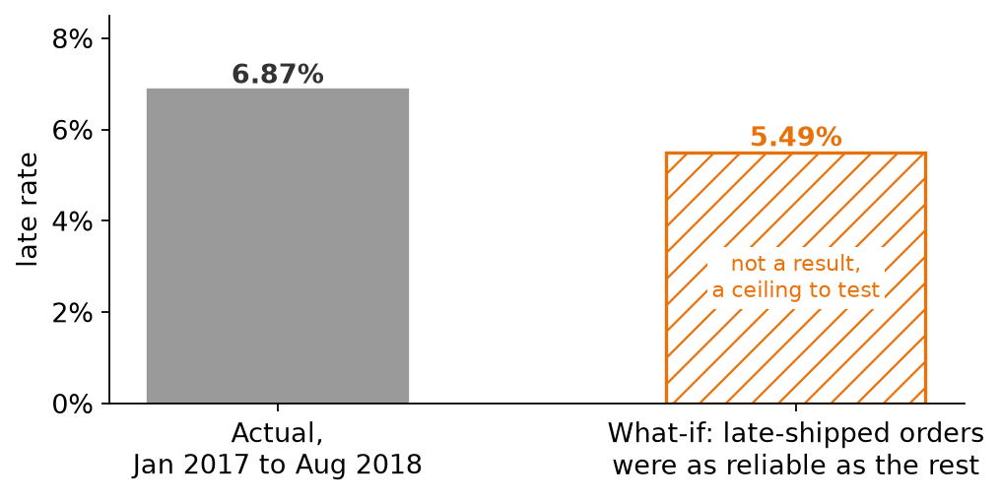
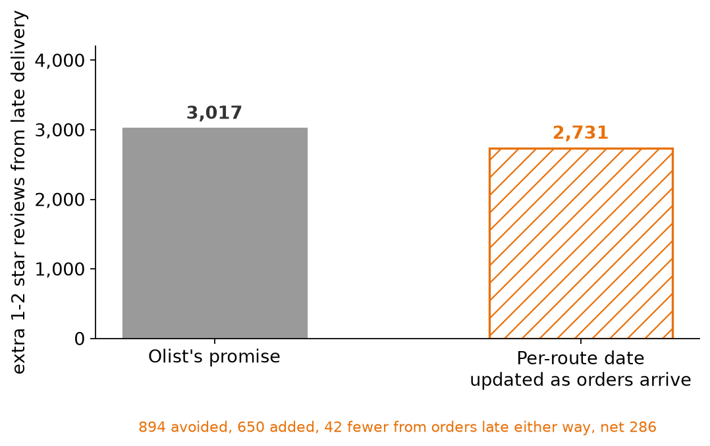

# Late deliveries and bad reviews at Olist

This project builds a tested data pipeline from about 99,000 real orders of Olist, a Brazilian online marketplace, and uses it to estimate what late delivery costs. The analysis found an estimated effect of late delivery on about 3,110 of the 11,635 one- and two-star reviews on 94,931 delivered orders, about 27%, with a range of 2,880 to 3,350. It is an estimate from past orders, not a randomized test, so it is not proven cause. Late delivery shows no clear effect on repeat buying. The recommendation is two randomized tests, starting with reminders to sellers about their ship-by date, because 27.8% of late orders were handed to the carrier late. A ship-by date is the deadline Olist gives a seller to hand the parcel to the carrier.

*The dashboard in one view. Click the image for the full-size picture. The interactive version is coming.*

**Role and tools.** An end-to-end analytics project on a public dataset: data modeling and automated data checks in dbt and DuckDB, the review-cost analysis in Python (pandas and statsmodels), a recommendation memo, a Quarto data story and a Tableau dashboard. GitHub Actions rebuilds and checks all of it.

**Code.** This repository. The main folders are [models/](../models/) (the dbt layers), [tests/](../tests/) (data checks), [review_cost_causal/](../review_cost_causal/README.md) (the estimate), [recommendation/](../recommendation/MEMO.md) (the memo), [dashboard/](../dashboard/tableau/README.md) (the Tableau workbook and its data) and [case_study/](../case_study/) (the checks behind this page). The short summary is the [README](../README.md).

## Question

What does late delivery cost Olist, and where should an operations manager act first? An order counts as late when it arrives on a later calendar day than the promised date. The question is broken into a tree of measurable parts in [story/QUESTIONS.md](../story/QUESTIONS.md).

## Approach

*Each step has its own checks, so a wrong number is caught where it starts.*

The source is nine tables from 2016 to 2018. Orders are the hub that items, payments, reviews and customers hang from.

*Keys and links of the nine source tables. Soft links (zip prefixes and product category) are not keys. A review ID can repeat across orders. Each mark was tested against the raw files, including that every column marked FK has a unique parent and no orphans. For the built models, see [the dbt lineage graph](LINEAGE.md).*

Three problems in the tables would have skewed the results.

- Every order has a new customer ID. There are 99,441 IDs for 96,096 people, so repeat buyers look like strangers until they are matched on the person ID.
- 1,278 orders ship from several sellers but carry one delivery date, so their late status cannot be observed. They are left out of the late rate.
- Review surveys can be sent before the parcel arrives. By calendar day, 5.19% of the reviews on delivered orders are dated before delivery.

The ZIP-prefix and product-category columns are drawn as soft links, not keys, because the data does not keep them unique or complete. A review ID can appear on more than one order.

### What the words mean

An ontology here is the project's agreed list of business concepts: what each one means, and where it lives in the data. The table and the rules below are generated from [ontology/ontology.yml](../ontology/ontology.yml), and a script checks them against the warehouse.

| Concept | Meaning | Lives in |
|---|---|---|
| Customer ID | A receipt number. Olist issues a new one for every order, so it cannot show a repeat buyer. | `staging.stg_customers.customer_id` |
| Person | A real buyer, identified by customer_unique_id. "Customer" in every metric means person. | `marts.dim_customer.customer_unique_id` |
| Order | One checkout by one customer. It can contain items from several sellers. | `marts.fct_orders.order_id` |
| Late | Delivered on a later calendar day than the promised date. Same-day delivery is on time. | `metrics.metric_late_rate_orders.is_late` |
| Ship-by date | The deadline Olist gives a seller to hand the parcel to the carrier. It is kept per item, and the order's ship-by date is the latest one among its items. | `marts.fct_orders.last_shipping_limit_at` |
| Handoff to carrier | The moment the seller gave the parcel to the carrier, as recorded on the order. Some orders have none. | `marts.fct_orders.delivered_to_carrier_at` |
| Late handoff | The handoff time is later than the order's ship-by time, compared as full timestamps. An order with no handoff time is in neither group. | `marts.fct_orders.delivered_to_carrier_at` |
| Multi-seller order | An order with items from two or more sellers (2+ parcels). Its parcels can arrive on different days, but Olist records one delivery date. | `marts.fct_orders.n_parcels` |

### What counts as late

Late. Delivered on a later calendar day than the promised date. Same-day delivery is on time. It is judged only on the late-rate population, after the filters below.

Late handoff. The handoff time is later than the order's ship-by time, compared as full timestamps. An order with no handoff time is in neither group. Among the judged orders, 94,930 have a handoff time and 8,530 of them were late. 1 judged order has no handoff time and is in neither group.

### Which orders are judged

The late rate uses a defined set of orders, not every row. The project setting `multi_seller_late_rule` is `exclude_multi_seller`. Each row shows how many orders remain after that filter.

| Step | Rule | Orders left | Removed |
|---|---|---|---|
| A | All orders in the source | 99,441 |  |
| B | Delivered, with a delivery date (delivery_state on time or late) | 96,470 | 2,971 |
| C | At least one item (n_items above zero) | 96,470 | none |
| D | Bought in the analysis window (in_analysis_window) | 96,203 | 267 |
| E | Single-seller orders only (delivery evidence is not multi-parcel) | 94,931 | 1,272 |

The 1,272 orders removed at the last step are the multi-seller orders that were still left. The source has 1,278 such orders. The other 6 were already removed by an earlier step. Each seller ships its own parcel, but the data keeps one delivery date for the order, so whether it was late cannot be observed.

Not delivered or conflicting: 2,957 not delivered, 14 with a status that disagrees with the delivery date. These orders have no reliable delivery outcome.

The cost estimate compares each late order with the same seller's orders that arrived just on time, in the same product category and month. Details are in [MODELING.md](../MODELING.md), [the lineage graph](LINEAGE.md) and [review_cost_causal/](../review_cost_causal/README.md).

## Findings

**Late orders are rare and rated much lower.** 6.87% of delivered orders (6,518 of 94,931) arrived late. Late orders average 2.27 stars and on-time orders 4.31. Among reviewed orders, 62.4% of late ones get one or two stars, against 8.7% of on-time ones.

*Bad reviews climb about 11 percentage points for each day late and level off near 78% from day 6. Part of the climb is survey timing.*

**About a quarter of the bad reviews are an estimated effect of lateness.** The estimate is about 3,110 of 11,635 (27%), and six reasonable ways of comparing give 2,880 to 3,350.

*Roughly one bad review in four on delivered orders is estimated to come from late delivery.*

**Repeat buying shows no clear effect.** 1.28% of customers order again within 90 days. After matching, customers whose first order was late came back 0.10 percentage points less often, with a range of -0.52 to 0.22 percentage points that includes zero.

**Lateness clusters in time and place.** Three months (November 2017, February 2018 and March 2018) hold 48.3% of late orders and 21.7% of all orders. The north and northeast regions run 12.2% late.

**Late seller handoff is the biggest linked source of lateness found.** On 9.0% of orders the seller handed the parcel to the carrier after the ship-by date. Those orders were late 21.2% of the time, against 5.4% when the handoff was on time.

*Orders shipped after the ship-by date are about four times as likely to arrive late, and they make up 27.8% of late orders.*

### The 4.4% goal and the 8.4% warning line

Both lines on the dashboard's monthly chart come from the data, not from a target set by hand. The warning line is a control limit: the average late rate of the stable months plus three standard deviations, widened to match how much the rate really swings from month to month, which is far more than chance alone would give (a Laney p-prime chart, method in [late_rate_targets/spc.py](../late_rate_targets/spc.py)). It sits at 8.4% for a typical month of 6,372 orders, and higher for smaller months. A month above it is a real change, not bad luck. Three months crossed it: November 2017, February 2018 and March 2018. The goal, 4.4%, is the median late rate of the 15 stable months, so half of them already beat it. A stable month is one that is not above the warning line and has enough orders to judge. Stable means not extreme. It does not mean healthy.

## Recommendation

Run two randomized tests before any rollout. Details and measures are in [recommendation/MEMO.md](../recommendation/MEMO.md).

1. **Ship-by reminders.** Half of the sellers, picked at random, get a reminder the day before each ship-by date and a visible on-time score. The other half see no change. Measure the share of late handoffs first, then the late rate and average stars, over 8 weeks.
2. **Buffer days in the promise.** For north and northeast addresses and in high-lateness months, add buffer days to the promised date on a random half of orders. Measure average stars and checkout conversion first. Conversion is not in the data and is the main risk.

*A ceiling for test 1, not a result. About 1,300 fewer late orders (20.6% of them) would take the late rate from 6.87% to 5.49%.*

**Why the dashboard says 3.4% and this page says 5.49%.** Both ask the same what-if: what would the late rate be if late-shipped orders were late only as often as the rest. They start from different bases. The 5.49% is the pooled version: it takes all 94,931 orders and moves the late rate from 6.87% to 5.49%. The 3.4% is the dashboard's version for a typical stable month: it moves the median stable month from the 4.4% goal down to 3.4%, a drop of about 1.0 percentage point. The pooled rate is higher because it includes the three spike months that a typical month leaves out.

### A short-term printed date

The analysis also replayed history with a per-route delivery date, updated as orders arrive, in place of Olist's single promise. Actual delivery times were left unchanged. On the 89,412 reviewed orders from April 2017 onward, the stricter 19-out-of-20 per-route date would likely have cut the extra one- and two-star reviews attributed to late delivery by about 9% (about 286 of 3,017), with a realistic range of about 7% to 11% from resampling orders. That cut is a net: about 2,337 orders that had been late would have been on time, avoiding about 894 bad reviews, while about 1,839 orders that had been on time would have been late, adding about 650, plus about 42 fewer from orders late either way. A looser 9-out-of-10 date made things worse. This is a printed-date stopgap, not a logistics fix. The data cannot show whether a different date would have changed who bought, or whether it would have raised repeat buying.

*A per-route 19-out-of-20 date cuts extra late-delivery bad reviews from about 3,017 to about 2,731, a net of about 286 (about 894 avoided, minus about 650 added, plus about 42 fewer from orders late either way).*

## How it was verified

- Each headline number is recalculated straight from the raw files and matches ([evidence/verification_report.md](../evidence/verification_report.md)).
- The keys and links in the diagram above pass 51 of 51 checks against the raw files, including that every column marked FK has a unique parent and no orphans ([case_study/erd.py](../case_study/erd.py)).
- Every data check was shown to fail on planted bad data. All 248 rules in the check suite are proven this way ([evidence/mutation_report.md](../evidence/mutation_report.md)).
- Every number in the memo is tied to the analysis output, and a script fails if one drifts ([recommendation/memo_check.py](../recommendation/memo_check.py)).
- Every number on this page is checked against the warehouse by [case_study/check_case_study.py](../case_study/check_case_study.py).
- GitHub Actions rebuilds the project and reruns all checks on every change. One command, `make`, reproduces everything ([docs/REPRODUCE.md](REPRODUCE.md)).

## Limits: what is causal and what is only linked

This page uses its labels the same way throughout. An estimated effect comes from comparing past orders and adjusting for seller, category and month. It is a reasonable estimate, not proven cause. Linked means seen together, with no cause claimed. Not shown means the data cannot tell.

| Statement | Status | Why |
|---|---|---|
| Late delivery is estimated to account for about 3,110 bad reviews | Estimated effect | Compared with the same seller's orders in the same category and month. It is an estimate from past orders, not a randomized test, so not proven cause. |
| Part of that effect is survey timing | Linked | 74.5% of late orders' surveys went out before delivery, so some customers rated while still waiting. |
| Hidden seller sloppiness inflates the estimate | Small | If it sat inside every late order it would explain about 150 of the reviews at the top of its range. |
| Late handoff leads to late arrival | Linked | The carrier may have been late anyway. The reminder test is what would show cause. |
| Late delivery lowers repeat buying | Not shown | The range includes zero, so the data cannot tell a real drop from chance. |
| The star penalty holds over time | Smaller recently | It was 1.56 stars in the last four months, against 2.05 earlier. |

The dashboard title says "linked to" for the first row and "fixable cause" for the handoff. Read the first as the estimated effect above and the second as the untested link in the handoff row.

The data has no revenue, commission or checkout figures, so the case for fixing lateness rests on ratings, not on money.

## What's next

Neither test has run. Test 1 needs seller-level random assignment and 8 weeks of orders. The what-if rate above is its upper bound until then.

## Go deeper

| To see | Open |
|---|---|
| The one-page decision memo | [recommendation/MEMO.md](../recommendation/MEMO.md) |
| The estimate and its checks | [review_cost_causal/README.md](../review_cost_causal/README.md) |
| The data story and KPI tree | [story/QUESTIONS.md](../story/QUESTIONS.md) |
| The dashboard and how it was built | [dashboard/tableau/README.md](../dashboard/tableau/README.md) |
| The official concept map | [ontology/ONTOLOGY.md](../ontology/ONTOLOGY.md) |
| Every table, grain and rule | [MODELING.md](../MODELING.md) |
| Setup, tests and every number | [docs/REPRODUCE.md](REPRODUCE.md) |
| The short summary | [README](../README.md) |

Data: the public [Olist Brazilian e-commerce dataset](https://www.kaggle.com/datasets/olistbr/brazilian-ecommerce) on Kaggle. Raw files are downloaded, not committed.
