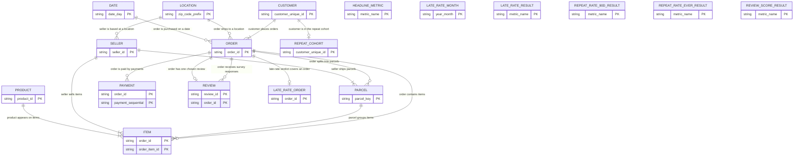
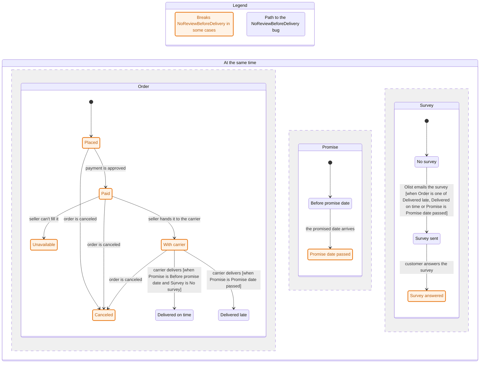

# Olist ontology

## In plain language

This folder is the official map of the Olist business. It names each business thing, says how the things connect, and defines every term and metric. People, dashboards and AI agents read the same definitions, so they get the same answers.

- **ontology.yml** is the single source of truth. Every definition card lives there.
- **check.py** proves every claim in ontology.yml against the built database. A wrong count, a broken link or a changed metric fails the check, and CI runs it.
- **order_lifecycle/** is a small model of the stages an order moves through, checked with a model checker (TLC).
- The MetricFlow semantic layer in `models/semantic/_semantic.yml` lets anyone ask for a metric by name, sliced by month or state, without writing SQL.

Four facts matter most:

1. A customer is a real person (`customer_unique_id`). Olist's `customer_id` is new on every order, like a receipt number.
2. An order can hold items from several sellers. Each seller's share is a parcel, but Olist records only one delivery date per order.
3. Late means delivered on a later calendar day than promised. Multi-seller orders are left out of the late rate (decision C1).
4. Olist's `review_creation_date` is the day it emailed the survey, not the day the customer wrote it. Olist emails the survey when the order arrives or when the promised date comes, whichever is first. That is why some reviews come before delivery.

## The business things and how they connect

Read each line as "one of the left thing has zero or more (o{), one or more (|{), or at most one (|o) of the right thing". This diagram is generated from ontology.yml (`python ontology/check.py --mermaid`), and the check fails if this copy drifts.



| Thing | One row is | Key | Rows |
|---|---|---|---|
| customer | one real person | customer_unique_id | 96,096<!--n:entities.customer.rows--> |
| order | one checkout, any status | order_id | 99,441<!--n:entities.order.rows--> |
| item | one item line on an order | order_id + order_item_id | 112,650<!--n:entities.item.rows--> |
| parcel | one seller's share of one order | parcel_key (order + seller) | 100,010<!--n:entities.parcel.rows--> |
| seller | one merchant | seller_id | 3,095<!--n:entities.seller.rows--> |
| product | one catalog product | product_id | 32,951<!--n:entities.product.rows--> |
| payment | one payment line on an order | order_id + payment_sequential | 103,886<!--n:entities.payment.rows--> |
| review | one survey response on one order | review_id + order_id | 99,224<!--n:entities.review.rows--> |
| location | one 5-digit zip prefix | zip_code_prefix | 19,015<!--n:entities.location.rows--> |
| date | one calendar day | date_day | 791<!--n:entities.date.rows--> |
| repeat cohort (supporting) | one person eligible for the 90-day repeat rate | customer_unique_id | 77,560<!--n:entities.repeat_cohort.rows--> |
| headline metric (supporting) | one headline number with its numerator and denominator | metric_name | 5 |
| late-rate order (supporting) | one order judged for lateness, with its verdict | order_id | 94,931<!--n:entities.late_rate_order.rows--> |
| late-rate month (supporting) | one purchase month's late rate | year_month | 20 |
| result tables (supporting) | the one-row results of the late rate, the 90-day repeat rate and the all-time repeat rate, and the two review metrics | metric_name | 1, 1, 1 and 2 |

Known gaps in the links, each counted and checked:

- 775<!--n:terms.parcel_count.counts.0.expected--> orders have no items and 1 order has no payment row.
- 768<!--n:terms.order_review_score.counts.0.expected--> orders have no survey response, and 547<!--n:facts.7.expected--> have more than one. Decision C4 picks the latest-answered one, so each order has at most one chosen review.
- 278<!--n:relationships.10.orphans--> orders and 7 sellers sit in a zip prefix that Olist's geolocation file does not have. They are kept, with no map point.
- The repeat cohort has 77,560<!--n:entities.repeat_cohort.rows--> people, one row each. Another 17,423<!--n:facts.1.expected--> of the 94,983<!--n:facts.0.expected--> people with a real purchase are left out. Their first purchase falls in the last 90 days of the data, so they had no full 90 days to come back.
- 789<!--n:facts.8.expected--> survey responses (`review_id`) are attached to more than one order, so a review's key is the response plus the order.

## The stages of an order

The model in `order_lifecycle/OrderLifecycle.tla` has three parts that move at the same time: the order's stage, whether the promised date has passed, and the survey. TLC checked all 29 reachable states.



The chart hides the final "nothing more happens" step. Every rule is recounted in the data by check.py. The Model column says what the TLA+ model knows about it: `holds` or `breaks` is what TLC found for a named invariant, and `not modeled` means the model has no invariant for that rule, so nothing but the data count backs it. TLC is run by hand, not in CI; check.py confirms each named invariant exists in `OrderLifecycle.tla` and `OrderLifecycle.cfg` and that its result matches `report.md`:

| Rule | Model | Data | What happens to the exceptions |
|---|---|---|---|
| A late order arrived after the promised day | holds | 0 exceptions | none needed |
| A delivery date exists exactly when the status is delivered | not modeled | 14 exceptions (8 delivered with no date, 6 canceled with a date) | labeled `status_date_conflict`, left out of delivery metrics |
| The carrier gets the order after payment approval | not modeled | 1,359<!--n:stage_rules.2.expected--> exceptions | raw timestamps out of order; no metric uses this gap |
| The customer gets the order after the carrier does | not modeled | 23 exceptions | raw timestamps out of order; lateness uses only delivery date and promise |
| The survey goes out only when the order is delivered or the promised date arrives | holds | 606<!--n:stage_rules.4.expected--> of 99,224<!--n:entities.review.rows--> responses | kept; flagged when a delivery date exists |
| The survey goes out on or after the purchase day | not modeled | 64 responses (part of the 606<!--n:stage_rules.4.expected-->) | source data error; kept |
| Nobody answers the survey before the order is delivered | **breaks** | 4,367<!--n:stage_rules.6.expected--> responses answered on an earlier day than delivery | not a real rule, see below |

The last rule is how people first state it, and the model shows why it is wrong. TLC's shortest path: the order is placed, the promised date passes, Olist emails the survey, and the customer answers, all before the parcel arrives. In the data, 4,713<!--n:facts.12.expected--> of the 5,127<!--n:facts.11.expected--> responses sent before delivery went out on or after the promised date, and 4,777<!--n:facts.13.expected--> of those 5,127<!--n:facts.11.expected--> belong to late orders. The early review is a symptom of lateness, which is why decision C2 keeps these reviews in the review score.

Rebuild the chart: `node --experimental-strip-types <path-to>/statechart.ts ontology/order_lifecycle/OrderLifecycle.tla --view ontology/order_lifecycle/view.ts --out /tmp/new-chart`.

## Column facts

`ontology.yml` has a `columns:` section. For each column the cards depend on, it gives the data type, the exact null count and the row rules. For example, `purchased_at` is a TIMESTAMP and never null. `n_parcels` is 0, not null, on an order with no items. `review_score` is null on the 768<!--n:terms.order_review_score.counts.0.expected--> orders with no response. It also has a `facts:` section of counts that span tables, such as the 17,423<!--n:facts.1.expected--> people left out of the repeat cohort. `check.py` proves every line of both against the warehouse.

## Glossary

Every term below has a full card in ontology.yml with its source column, grain, population, time rule and examples that do not count.

| Term | Plain meaning | Does not count |
|---|---|---|
| person | A real buyer (`customer_unique_id`). "Customer" in every metric means person. | `customer_id`, which is one per order |
| qualifying order | An order that counts as a real purchase. Not canceled or unavailable, with at least one item. | canceled, unavailable, or empty orders |
| purchase time | The second the order was placed. The column is `purchased_at`, a TIMESTAMP that is never null. `purchase_date` is only its day. The 24-hour rule in the repeat rate uses `purchased_at`. | `purchase_date`, which has no time |
| qualifying order sequence | `customer_qualifying_order_seq` is 1 on the person's first qualifying order, 2 on the next, and null on a non-qualifying order. | a canceled order (null) |
| repeat return | A later qualifying order whose `purchased_at` is at least 24 hours and at most 90 days after the first one's. Both ends count. | an order 3 hours later, a canceled order, day 91 |
| repeat cohort member | A person whose first qualifying order is at least 90 days older than the newest qualifying purchase, 2018-09-03 09:06:57. The cutoff is therefore 2018-06-05 09:06:57. The members are the rows of `metrics.metric_repeat_rate_90d_people`. | people with only recent first purchases, people with only canceled orders |
| repeat slice | The first-order month is the month of `first_order_date`. The first-order state is the `ship_to_state` of the person's `seq = 1` order, joined on `customer_unique_id`. | `dim_customer.state`, which is the latest address, and the month of the second order |
| placed an order | A person with at least one order of any status. That is every row of `dim_customer`, 96,096<!--n:terms.placed_an_order.counts.0.expected--> people. | counting only qualifying orders. That gives 94,983<!--n:terms.placed_an_order.counts.1.expected--> people and drops 1,113<!--n:terms.placed_an_order.counts.2.expected--> whose orders were all canceled, unavailable or empty |
| canceled order | An order with `order_status = 'canceled'`. There are 625<!--n:terms.canceled_order.counts.0.expected-->, including 6 that still carry a delivery date and also show `status_date_conflict`. The denominator for a share is every order. | status `unavailable`, or "not delivered" in general |
| parcel count | `n_parcels` is 0 on an order with no items (775<!--n:terms.parcel_count.counts.0.expected--> orders) and never null. It is 1 on a normal order and 2 or more on a multi-seller order. | treating it as null for empty orders |
| order review score | `fct_orders.review_score` holds the stars, 1 to 5, of the chosen response. It is null on the 768<!--n:terms.order_review_score.counts.0.expected--> orders with no response. | an earlier answer on the same order |
| promised date | The delivery date promised at purchase. A date with no time. | |
| delivered | Status is delivered and a delivery date exists (96,470<!--n:terms.delivered.count.expected--> orders). Use `delivery_state`, not "has a delivery date", which also catches 6 canceled orders. | delivered status without a date, shipped orders |
| late | Delivered on a later calendar day than promised. | same-day delivery at 23:00, multi-seller orders, undelivered orders |
| multi-seller order | An order with items from 2 or more sellers (1,278<!--n:terms.multi_seller_order.count.expected--> orders). | one seller shipping 3 items |
| analysis window | Full months 2017-01 through 2018-08. `in_analysis_window` is true or false and never null. 349<!--n:terms.analysis_window.counts.1.expected--> orders are outside. | partial edge months |
| survey sent | The day Olist emailed the survey (`review_creation_date`). | the day the customer answered |
| chosen review | The one response used per order: the latest answered. | earlier answers on the same order |
| survey sent before delivery | The survey went out on an earlier day than the delivery (column `review_before_delivery`). | same-day survey; responses on undelivered orders (null) |
| ship-to address | Where this order shipped, at order time. Geography metrics use it. | the person's latest address on dim_customer |
| payment recon | Whether paid equals items plus freight. | |

## Metrics

| Metric | Value | Numerator / denominator | Population |
|---|---|---|---|
| repeat_rate_90d (headline) | 1.28<!--n:metrics.repeat_rate_90d.verified.value_pct-->% | 991<!--n:metrics.repeat_rate_90d.verified.numerator--> / 77,560<!--n:metrics.repeat_rate_90d.verified.denominator--> people | people with a full 90 days after their first real purchase; a return must be 24 hours to 90 days later |
| repeat_rate_ever | 3.04<!--n:metrics.repeat_rate_ever.verified.value_pct-->% | 2,887<!--n:metrics.repeat_rate_ever.verified.numerator--> / 94,983<!--n:metrics.repeat_rate_ever.verified.denominator--> people | anyone with a real purchase; any second order counts |
| late_rate | 6.87<!--n:metrics.late_rate.verified.value_pct-->% | 6,518<!--n:metrics.late_rate.verified.numerator--> / 94,931<!--n:metrics.late_rate.verified.denominator--> orders | delivered orders with items, in the window, single-seller only |
| review_score | 4.156<!--n:metrics.review_score.verified.value_pct--> stars | 397,176<!--n:metrics.review_score.verified.numerator--> / 95,560<!--n:metrics.review_score.verified.denominator--> orders | delivered orders with items and a review, in the window; multi-seller included |
| late_review_gap_raw | 2.04<!--n:metrics.late_review_gap_raw.verified.value_pct--> stars | 94,302<!--n:metrics.late_review_gap_raw.verified.denominator--> orders | on-time minus late average, late-rate population, unadjusted |

check.py confirms each value three ways: the card, the dbt metric table, and MetricFlow's own sum of row-level numbers. `make verify` also recomputes the first four from the raw CSVs.

## Asking questions

```sh
mf query --metrics late_rate,judged_orders --group-by metric_time__month
mf query --metrics late_rate --group-by order__ship_to_state --order -late_rate
mf query --metrics repeat_rate_90d,review_score
```

Run `dbt parse` (or `make build`) first. MetricFlow reads `target/semantic_manifest.json`, and a stale one gives "no matching group-by" errors.

## Why MetricFlow plus YAML cards

Both options were built and run on this warehouse (2026-11-17).

| | (a) MetricFlow semantic models + cards | (b) YAML cards + existing metric tables |
|---|---|---|
| Setup | 1 package (dbt-metricflow 0.16.0, same dbt/duckdb pins, 13 s install), 75-line YAML, a time spine on dim_date, and one refactor so the repeat population has a row per person | no new package |
| Reproduces the numbers | yes: 6,518<!--n:metrics.late_rate.verified.numerator-->/94,931<!--n:metrics.late_rate.verified.denominator-->, 991<!--n:metrics.repeat_rate_90d.verified.numerator-->/77,560<!--n:metrics.repeat_rate_90d.verified.denominator-->, 397,176<!--n:metrics.review_score.verified.numerator-->/95,560<!--n:metrics.review_score.verified.denominator--> and all 20 months, summed from rows | yes, but only by reading the same rows it is compared to |
| New questions | any metric by month, by state or by order field, no new SQL | only what a metric table already holds; anything else needs hand SQL |
| CI | `make verify` runs check.py, which calls `mf query`; no workflow change | same script without the MetricFlow calls |
| Gotchas | needs a fresh `target/semantic_manifest.json`; cannot query while another process holds the DuckDB file | none |

MetricFlow ships. Its numbers are an independent recomputation, and it answers sliced questions that (b) cannot. The cards ship in both options, because MetricFlow has no field for "does not count" examples, cardinality or stage rules.
