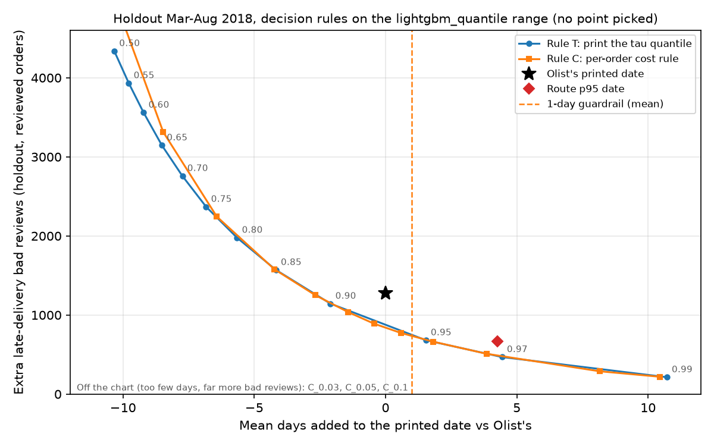

# Delivery date as a predicted range plus a separate rule

The earlier per-order model ([../delivery_date_model](../delivery_date_model/README.md)) did two jobs at once: it
predicted how long delivery takes and chose which date to print. This folder splits those jobs:

1. **Prediction layer** (`predict.py`): for each order, a range of likely delivery times, as quantiles from 5% to 99%.
   It knows nothing about promises or reviews.
2. **Decision layer** (`decide.py`): turns that range into a printed date. It reads only the predicted quantiles and
   the published late-to-bad-review effects.

This makes the trade-off visible: each setting of the rule gives a point with "days added to the promise" on one axis
and "extra bad reviews" on the other. **No point is picked here.** Which one to ship, and whether 1 day is the right
limit, are business calls.

The pass rules were written before the run, in [docs/preregistration_v2.md](../../docs/preregistration_v2.md) (part d).
Results: `evidence/delivery_range_report.json`. Rerun (about 16 minutes on 8 cores, needs `make build`) in a separate
virtual environment, installing both requirement files in one command so pip keeps pandas at 3.1.1:

```bash
python -m venv .venv-range
.venv-range/bin/pip install -r requirements.txt -r recommendation/delivery_range/requirements.txt
.venv-range/bin/python recommendation/delivery_range/run.py
```

The committed results come from pandas 3.1.1, numpy 2.5.5, scikit-learn 1.9.1, LightGBM 4.7.0 and NGBoost 0.6.1. A
clean rerun with those versions and no cached predictions gave the same numbers and the same plot. Only the run times
differed.

## Set-up

- **Same split as the earlier model.** Walk-forward from January 2017 (each month retrained on orders delivered before
  it, with a 45-day label lag), tune on November 2017 to February 2018, holdout March to August 2018 (38,511 judged
  orders). `run.py` checks the order IDs of both blocks against the hashes in the pre-registration.
- **The holdout is locked, not fresh.** Earlier models in this repo already scored these months, so the design was
  shaped after earlier looks at them. Nothing newer exists in the data.
- **Same checkout-time features** as `../delivery_date_model/features.py`.
- **Candidates.** scikit-learn gradient boosting (one quantile model per level), LightGBM (same), and NGBoost with a
  log-normal distribution. The two boosting models reuse the earlier model's setting (learning rate 0.05, 300 trees,
  15 leaves, 200 orders per leaf). NGBoost used 400 rounds at 0.03 and was not tuned. Baseline with no model: the
  route's own past delivery times at each level.
- **Scores.** CRPS, the average distance between the predicted range and what happened (in days, lower is better),
  approximated from 19 evenly spaced quantiles. Calibration: for each level, the share of orders that arrived within
  it; the error is the largest gap between 50% and 95%.

## Prediction layer

| | CRPS, tune | CRPS, holdout | Calibration error, holdout | Arrived within the 90% quantile, holdout |
|---|---|---|---|---|
| scikit-learn boosting | 4.810 | 3.611 | 14.7 points | 91.8% |
| **LightGBM (picked on tune)** | **4.798** | **3.601** | **14.8 points** | **91.9%** |
| NGBoost log-normal | 4.810 | 3.535 | 16.0 points | 93.2% |
| Route history (no model) | 5.188 | 3.784 | 17.1 points | 92.9% |

LightGBM was picked on the tune block, by a margin of 0.012 days, before the holdout was scored. On the holdout,
NGBoost scored better; the pick was not changed.

**The ranges are not well calibrated.** On the tune block, which holds two peak months, orders arrived slower than
predicted: only 78.7% arrived within the 90% quantile. On the holdout, after the March peak, they arrived faster: 64.8%
arrived within the 50% quantile. A model retrained each month on older orders probably lags
behind shifts in delivery speed in both directions. This was not tested. So "the 90% date" is not a 90% promise. The decision layer below is
scored on actual delivery days, not on the stated levels.

## Decision layer

- **Rule T:** print the predicted quantile at level tau, rounded up.
- **Rule C:** for each order, pick the whole-day date that minimizes expected extra bad reviews plus lambda times the
  days promised. Lambda is the price of a promise day in bad reviews. At lambda = 0.004, one bad review avoided is worth
  250 extra promise days spread over all orders. A long range gets a later date and a tight one an earlier date.

Holdout, 38,511 orders. Extra late-delivery bad reviews are projected from actual delivery days and the V2 effects, on
reviewed orders. They are not observed reviews under a new date. Olist's printed
date gives 1,275 extra bad reviews, with a mean promise of 22.5 days and a median of 22. Selected points (the full
sweep is in the report):

| Rule | Mean days vs Olist | Median promise | On time | Projected extra bad reviews | Fewer than Olist, projected (95% bootstrap) | March 2018, projected (Olist 658) |
|---|---|---|---|---|---|---|
| T, tau 0.90 | -2.1 | 20 | 93.3% | 1,144 | 131 (99 to 167) | 662 |
| C, lambda 0.006 | -1.4 | 21 | 94.0% | 1,036 | 239 (206 to 274) | 602 |
| C, lambda 0.005 | -0.4 | 22 | 94.8% | 891 | 384 (351 to 419) | 522 |
| C, lambda 0.004 | +0.6 | 23 | 95.5% | 773 | 502 (468 to 539) | 463 |
| T, tau 0.95 | +1.5 | 23 | 96.0% | 682 | 593 (558 to 630) | 412 |
| Route p95 date | +4.3 | 24 | 96.3% | 670 | 605 (567 to 646) | 418 |



Within the 1-day guardrail (mean at most 1.0 day longer than Olist's promise, median at most 1 day longer), the best
point is rule C at lambda 0.004: a projected 502 fewer extra bad reviews (39%) for 0.6 more days on average. At lambda
0.005 the promise is shorter than Olist's on average and the projected cut is 384. Rules T and C give nearly the same curve, with C a
little lower near the guardrail. The route p95 date cuts about as many as tau 0.95 but needs 4.3 days.

## Pass rules

| Rule | Result |
|---|---|
| D-1. Picked model beats the route-history baseline on holdout CRPS, paired bootstrap 2.5th percentile above 0 | **Pass** (0.18 days better, 0.16 to 0.20) |
| D-2. Picked model's holdout calibration error at most 3 points | **Fail**, 14.8 points. See the finding below. |
| D-3. (Finding, not a launch decision) some point inside the guardrail cuts extra bad reviews, bootstrap 2.5th percentile above 0 | **Yes**: tau 0.90 and lambda 0.004, 0.005, 0.006 |

## Finding: rule D-2 failed

- **The range is not a calibrated promise.** The calibration error is 14.8 points against a limit of 3. On the tune
  months, which hold two peak months, orders arrived slower than predicted, and 78.7% arrived within the 90% quantile.
  On the holdout they arrived faster, and 64.8% arrived within the 50% quantile. The probable cause is that a model
  retrained each month on older orders lags behind changes in delivery speed. This was not tested.
- **It is not ready to ship.** "The 90% date" does not mean 90% of orders arrive by it. The decision-layer results above
  are projected from actual delivery days and the V2 effects, so they still work as a comparison between rules. They do
  not show that the model's stated levels hold. A launch would first need recalibration on recent deliveries, tested on
  months it was not built on.
- **The holdout was not fresh.** Earlier models in this repo already scored March to August 2018, so these results were
  shaped by earlier looks at the same months.
- The rule was set before the run and has not been changed. This is recorded as a fail.

## Left to decide (not by this analysis)

- Which point to ship, if any: a tau, a lambda, or none.
- Whether a 1-day limit on the average promise is the right business limit.

## Limits

- Calibration failed (D-2); see the finding above.
- The holdout months were seen by earlier models in this repo.
- The bad-review effects come from the whole window, holdout included, and are treated as fixed. The bootstrap only
  reflects which orders happened to fall in the holdout, not uncertainty in the effects.
- The projection assumes reviews respond only to how many days late an order arrives, not to the date printed at
  checkout. If a later printed date itself lowers satisfaction, the projected cuts are too high.
- A shorter or longer date may change who buys. There is no checkout data here, so that cost is not counted.
- No settings were tuned for this comparison. LightGBM and scikit-learn reuse the earlier model's setting, and NGBoost
  used one untuned setting.
