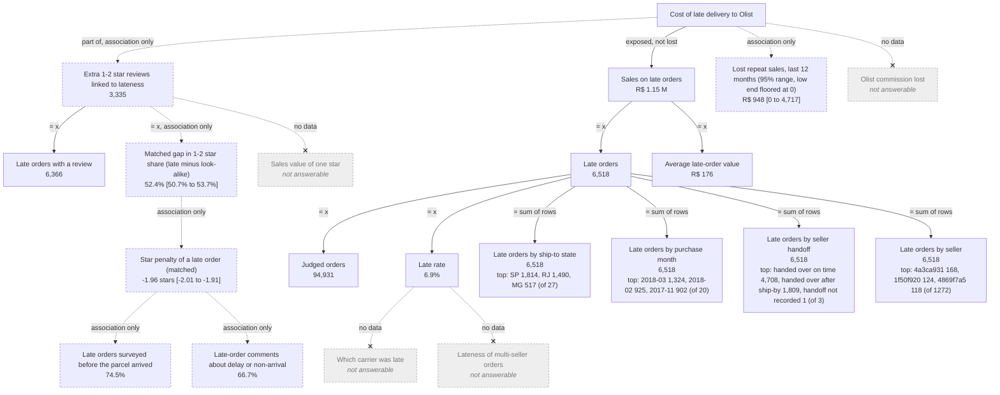

# Question brief: where to reduce late deliveries

The reader is an Olist operations manager who must decide where to spend effort on late deliveries. This brief starts with a KPI tree. The tree puts the cost of late delivery at the root and breaks it into the numbers an operations manager can act on. The questions come from the tree.

Every measured node is computed by `story/kpi_tree.py` from `marts.fct_orders` and `marts.fct_reviews`, at the grain of one judged order. A judged order is a single-seller order bought from January 2017 to August 2018 and delivered. That is the population of the ontology's late rate, `metrics.late_rate`. The matched estimates come from `recommendation/analyze.py`, which compares each late order with on-time orders in the same state, category, freight band and month.

## KPI tree

How to read the edges:

- A solid arrow marked "= sum of rows" means the parent equals the sum of the child's rows. Late orders split by state, by month, by seller and by seller handoff each add back to the 6,518 late orders.
- A solid arrow marked "= x" means the parent equals the product of its "= x" children.
- A solid arrow marked "exposed, not lost" leads to sales that went through a late delivery. That money was paid, not lost.
- A dashed arrow marked "association only" (or "part of, association only") means the child is linked to the parent by a matched comparison or by comment text. The data cannot show that one causes the other.
- A dashed arrow marked "no data" ends at a grey node. The data has no column that could answer it.

`python story/kpi_tree.py --check` fails if any breakdown stops adding up, if a product drifts, if a value disagrees with `evidence/recommendation_report.json`, if a claim id is missing from the ontology, if a matched estimate or a node that reads comment text loses its association mark, if a threshold is typed (as a numeral or a number word) instead of taken from `thresholds:` in `story/kpi_tree.yml`, or if this section or a Threshold line below is stale. `story/selftest_kpi_tree.py` plants sixteen such errors and requires each one to fail. Both run in `make verify`.

The cost has two measured parts, in different units, so they are not added. The ratings part is 3,335 extra 1-2 star reviews over 20 months, 28.7% of all 1-2 star reviews. The sales part is R$1.15 million paid for late orders over 20 months, R$1.00 million of it in the last 12 months (8.6% of R$11.6 million). That money went through a late delivery. It was not lost. A third part, lost repeat sales, cannot be told apart from zero.

<!-- kpi-tree:start (generated by story/kpi_tree.py; do not edit) -->

| Node | Value | Edge to parent | Grain | Counts | Denominator | Why it moves | Threshold that changes the action | Model / metric | Ontology claims | Answerable |
|---|---|---|---|---|---|---|---|---|---|---|
| **Cost of late delivery to Olist** (`cost`) | - | root | judged order | two parts measured separately, ratings at risk and sales that went through a late delivery (plus a repeat-revenue part the data cannot tell from zero) | - | - | - | - | metrics.late_rate, metrics.late_review_gap_raw | yes |
| **Extra 1-2 star reviews linked to lateness** (`low_star_excess`) | 3,335 | one measured part of the parent (association only) | reviewed judged order | reviewed late orders times the matched gap in the share of 1-2 star reviews | none (a count) | more late orders, or a wider star gap between late orders and on-time look-alikes | above 10% of all 1-2 star reviews, lateness is a top ratings problem worth a funded test | marts.fct_orders, marts.fct_reviews; recommendation_report.json: money.low_star_reviews.excess_from_lateness.mid | terms.chosen_review, terms.order_review_score, metrics.late_review_gap_raw | association only (rests on the matched gap) |
| **Late orders with a review** (`late_reviewed`) | 6,366 | parent = product of the x children | judged order | judged late orders whose chosen review has a score | - | - | - | marts.fct_orders | terms.late, terms.chosen_review | yes |
| **Matched gap in 1-2 star share (late minus look-alike)** (`excess_low_star_share`) | 52.4% [50.7% to 53.7%] | parent = product of the x children (association only) | reviewed judged order, compared within matched cells (state x category x freight band x month) | late orders' 1-2 star share minus that of on-time orders in the same state, category, freight band and month | - | product and seller quality differences the match cannot see would move it too | - | marts.fct_orders; recommendation_report.json: low_star.all.matched.effect | metrics.late_review_gap_raw | association only |
| **Star penalty of a late order (matched)** (`star_penalty`) | -1.96 stars [-2.01 to -1.91] | association only (matched comparison or text) | reviewed judged order, within matched cells | average stars of late orders minus matched on-time look-alikes | - | - | a penalty under 0.5 star would make ratings a weak reason to act | marts.fct_orders; recommendation_report.json: stars.all.matched.effect | metrics.review_score, metrics.late_review_gap_raw | association only |
| **Late orders surveyed before the parcel arrived** (`survey_before_share`) | 74.5% | association only (matched comparison or text) | reviewed judged late order | reviewed late orders whose survey went out on an earlier day than the delivery | - | the survey usually goes out around the promised date, so a late parcel is often still on the way (ontology terms.survey_sent_before_delivery) | - | marts.fct_orders | terms.survey_sent_before_delivery | yes |
| **Late-order comments about delay or non-arrival** (`comment_not_arrived_share`) | 66.7% | association only (matched comparison or text) | judged late order with a comment | chosen-review comments on late orders that mention not receiving the product, delay or the deadline (Portuguese keyword rule) | - | more parcels still on the way when the survey arrives | - | marts.fct_reviews | columns.marts.fct_reviews.review_comment_message, terms.chosen_review | yes (text evidence) |
| **Sales on late orders** (`late_sales`) | R$ 1.15 M | one measured part of the parent | judged order | what customers paid for judged late orders; this money went through a late delivery, it was not lost | - | - | no bar on its own; it sizes the exposure, not a loss | marts.fct_orders | columns.marts.fct_orders.amount_paid, terms.late | yes |
| **Late orders** (`late_orders`) | 6,518 | parent = product of the x children | judged order | judged orders delivered on a later calendar day than promised | none (a count) | - | - | marts.fct_orders | terms.late, metrics.late_rate | yes |
| **Average late-order value** (`avg_late_order_value`) | R$ 176 | parent = product of the x children | judged order | - | - | - | - | marts.fct_orders | columns.marts.fct_orders.amount_paid | yes |
| **Judged orders** (`judged_orders`) | 94,931 | parent = product of the x children | judged order | - | - | - | - | marts.fct_orders | metrics.late_rate, terms.analysis_window, terms.multi_seller_order | yes |
| **Late rate** (`late_rate`) | 6.9% | parent = product of the x children | judged order | - | judged orders | carrier delays, seller handoffs after ship-by, promises too short for the route or season | a segment at 1.75x the overall rate that holds 10% or more of late orders is worth targeting | marts.fct_orders | metrics.late_rate, terms.late | yes |
| **Late orders by ship-to state** (`late_by_state`) | 6,518 | parent = sum of these rows | judged order | - | - | - | - | marts.fct_orders | terms.ship_to_address | yes |
| **Late orders by purchase month** (`late_by_month`) | 6,518 | parent = sum of these rows | judged order | - | - | - | - | marts.fct_orders | metrics.late_rate_monthly | yes |
| **Late orders by seller handoff** (`late_by_handoff`) | 6,518 | parent = sum of these rows | judged order | - | - | sellers missing their ship-by date | if late handoffs are 20% or more of late orders and run late at 2x the on-time-handoff rate, test seller reminders | marts.fct_orders | columns.marts.fct_orders.delivered_to_carrier_at, columns.marts.fct_orders.last_shipping_limit_at | yes |
| **Late orders by seller** (`late_by_seller`) | 6,518 | parent = sum of these rows | judged order | each judged order has exactly one seller (single-parcel orders), so sellers split late orders without overlap. Category is not a breakdown here because one order can hold items from several categories. | - | - | - | marts.fct_orders, marts.fct_order_items | terms.multi_seller_order | yes |
| **Lost repeat sales, last 12 months (95% range, low end floored at 0)** (`lost_repeat_sales`) | R$ 948 [0 to 4,717] | association only (matched comparison or text) | customer's first judged order | late first orders in the last 12 months times the matched drop in 90-day repeat rate times a repeat buyer's 90-day spend | - | - | worth a retention budget only if the repeat drop's range excludes zero; it does not | marts.fct_orders, marts.dim_customer; recommendation_report.json: money.lost_repeat_gmv_last12.mid | metrics.repeat_rate_90d, terms.repeat_return | association only |
| **Olist commission lost** (`commission`) | - | no data | - | no commission or take-rate column in the data | - | - | - | - | - | no |
| **Sales value of one star** (`star_sales_value`) | - | no data | - | no traffic, ranking or conversion data to price a star | - | - | - | - | - | no |
| **Which carrier was late** (`carrier`) | - | no data | - | no carrier id in the data | - | - | - | - | - | no |
| **Lateness of multi-seller orders** (`multi_seller_arrival`) | - | no data | - | one delivery date for several parcels, so these orders are left out of the late rate (decision C1) | - | - | - | - | terms.multi_seller_order | no |
<!-- kpi-tree:end -->

## Questions

Each question names the decision it informs, the number that answers it, and the threshold that would change the action. Thresholds were set before the story charts were drawn. They were not set before the memo's analysis, which had already seen these numbers.

### Q1. How much does late delivery cost Olist?

- **Decision.** Fund delivery tests at all, or spend the effort elsewhere.
- **Metric.** Extra 1-2 star reviews linked to lateness, as a share of all 1-2 star reviews. Second metric: sales paid for late orders in the last 12 months of the window, as exposure.
- **Threshold.** If lateness is linked to 10% or more of all 1-2 star reviews, it is a top ratings problem and worth a funded test.
- **Answer.** 28.7% of the 11,635 1-2 star reviews on judged orders (delivered single-seller orders), range 27.7% to 29.4%. In the last 12 months, R$1.00 million of sales, 8.6%, went through a late delivery. Spread evenly over the 20-month window, it is R$0.7 million a year; the window average is lower because sales grew and the late share rose.
- **Claims.** `metrics.late_review_gap_raw`, `terms.chosen_review`, `terms.order_review_score`, `terms.late`, `columns.marts.fct_orders.amount_paid`.
- **Limit.** The extra reviews come from a matched comparison, an association. The ontology has no column that turns a star into sales or commission.

### Q2. Where and when do late orders pile up?

- **Decision.** Which addresses and which months get extra buffer days on the promised date.
- **Metric.** Late rate by ship-to state and by purchase month, with each segment's share of all late orders.
- **Threshold.** A segment is a target if its late rate is at least 1.75 times the overall late rate and it holds at least 10% of late orders.
- **Answer.** North and northeast addresses run at 12.2% and hold 20% of late orders. The three highest-lateness months, March 2018, February 2018 and November 2017, run at 19.2%, 14.2% and 12.5% and together hold 48% of late orders. North and northeast (range 11.6% to 12.8%) and November 2017 (range 11.8% to 13.3%) are borderline: their ranges straddle the 12.0% bar. The window has one November, so it does not show that every November is late. Rio de Janeiro runs at 12.3%, but most of that is a spike in a few months.
- **Claims.** `metrics.late_rate`, `metrics.late_rate_monthly`, `terms.ship_to_address`, `terms.promised_date`.

### Q3. How much lateness starts with the seller?

- **Decision.** Whether to test holding sellers to their ship-by date.
- **Metric.** Share of late orders whose seller handed the parcel to the carrier after the ship-by date, and the late rate of those orders against orders handed over on time.
- **Threshold.** Test the seller fix if late handoffs are 20% or more of late orders and run late at least 2 times as often as on-time handoffs.
- **Answer.** 27.8% of late orders, 1,809 of 6,518. Late handoffs end late 21.2% of the time, against 5.4% for on-time handoffs, 3.9 times as often.
- **Claims.** `columns.marts.fct_orders.delivered_to_carrier_at`, `columns.marts.fct_orders.last_shipping_limit_at`, `terms.late`.
- **Limit.** A late handoff comes before the late delivery, but the carrier may have been late anyway. At most 1,344 late orders, 20.6%, would have been on time with an on-time handoff.

### Q4. What do customers with late orders write?

- **Decision.** Treat the lower stars as a delivery problem, or look for a product problem first.
- **Metric.** Share of late-order comments that say the product did not arrive, arrived late, or missed the deadline, read from the Portuguese `review_comment_message` text with a keyword rule. Second metric: share of reviewed late orders whose survey went out before the parcel arrived.
- **Threshold.** If 50% or more of late-order comments are about delay or non-arrival, this plan treats the low stars as a delivery problem and leaves product fixes out.
- **Answer.** 66.7% of late-order comments. The rule found no false matches in 70 hand-labelled comments, but only 20 of them were not about delay, and a later spot check found a clear false match ("chegou no prazo", arrived on time). It missed 23% of delay comments in the 30 labelled after it was frozen. Misses push the share up and false matches push it down, so 66.7% is an estimate, not a floor. 74.5% of reviewed late orders got the survey before the parcel arrived.
- **Claims.** `columns.marts.fct_reviews.review_comment_message`, `terms.chosen_review`, `terms.survey_sent_before_delivery`.

### Q5. Do late orders cost repeat purchases?

- **Decision.** Whether retention money belongs in the case for these tests.
- **Metric.** Matched difference in the 90-day repeat rate after a late first order.
- **Threshold.** Count repeat sales in the case only if the difference's range excludes zero.
- **Answer.** Minus 0.10 points, range minus 0.52 to plus 0.22. The range includes zero, so the case rests on ratings. Before matching the gap is minus 0.28 points, range minus 0.55 to just below zero, which excludes zero; matching on state, category, freight band and month removes most of it.
- **Claims.** `metrics.repeat_rate_90d`, `terms.repeat_return`.

## Questions dropped or reworded

| Original question | What happened | Why |
|---|---|---|
| Does late delivery cause low ratings? | Reworded to "how much lower are ratings on late orders than on matched on-time orders" | The data shows an association. Only a randomized test shows cause. |
| When did each parcel of a multi-seller order arrive? | Dropped | One delivery date covers several parcels, so these orders are not judged late or on time. Ontology decision C1, `terms.multi_seller_order`. |
| Which carrier is to blame? | Dropped | The data has no carrier id. |
| What is one star worth in sales? | Dropped | The data has no traffic, ranking or conversion figures. |
| How much commission does Olist lose? | Dropped | The data has no commission or take-rate column. |
| Which product categories run late? | Replaced by late orders by seller | One order can hold items from several categories, so categories do not split late orders without overlap. Each judged order has exactly one seller. |
